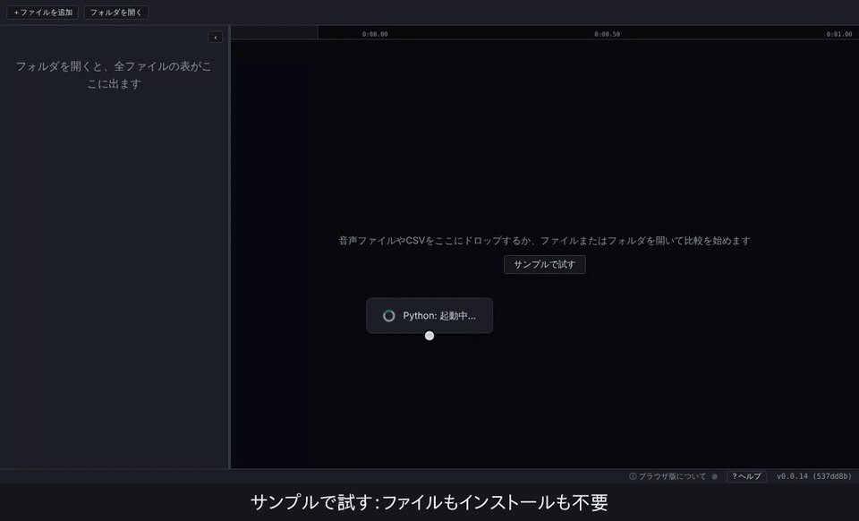
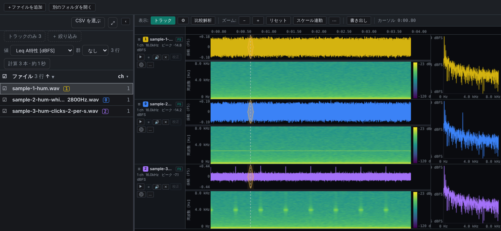
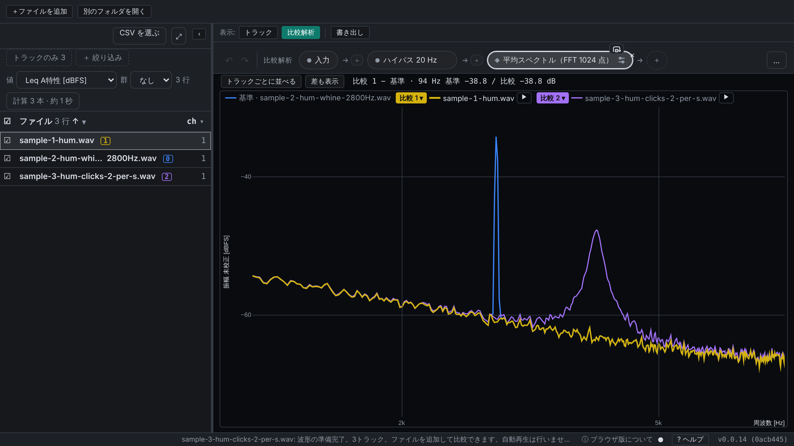

# Audio Wandas Analyzer

[English](https://github.com/kasahart/audio-wandas-analyzer/blob/main/README.md) | **日本語**

**違って聞こえる録音を見つけて、どこが違うかを確かめる。** 録音を並べて同じ時間軸で聴いて見比べ、スペクトルなどの解析結果を同じ軸に重ねて比べられます。

**[▶ ブラウザーで試す](https://kasahart.github.io/audio-wandas-analyzer/)**：**サンプルで試す** を押すだけ。ファイルもインストールも要りません。音声は端末の外に出ません。長い録音や校正には [VS Code 拡張](https://marketplace.visualstudio.com/items?itemName=audio-wandas-analyzer.audio-wandas-analyzer) を使います。



*同梱サンプル：同じハムに、2.8 kHz の純音が乗ったものと、クリックが乗ったもの。*

## 使い方

1. **開く**：ファイルかフォルダごと開きます。全ファイルが表に並び、☐ でトラックに出します。
2. **聴いて見る**：トラックごとに波形とその下のスペクトログラムを同じ時間軸で表示し、横にカーソル位置のスペクトル。再生・ループ・ミュート・時間ずらしで揃えます。
3. **比べる**：基準と、比べる録音を 3 本まで選びます（キー `0`〜`3`）。結果は役割ごとの色で重ねて描かれます（基準は青、比較は黄・紫・マゼンタ）。
4. **手順で解析する**：手順バーは [wandas](https://github.com/kasahart/wandas) のメソッドチェーンです（例：*入力 → ハイパス 20 Hz → 平均スペクトル*）。**＋** で wandas の処理を好きな位置に足し、手順を押すとその段の結果を全録音で見られます。
5. **持ち出す**：PNG・CSV・WAV・Markdown / Notebook のレポートを書き出し、手順は wandas だけで実行できる `.recipe.json` として保存できます。





## ほかにも

- **大量のファイル**：表にファイルごとの値（A 特性 Leq など）を出して並べ替え・絞り込み・群分け。属性 CSV（異常スコアや条件など）を読み込んで候補を絞れます。
- **基準トラック**：基準から他のトラックへの伝達関数とコヒーレンス。
- **校正**：Pa、m/s²、V に換算し、dB SPL などで表示（VS Code 版）。
- **同梱レシピ**：ラウドネス、ラフネスなど。
- **形式**：WAV、FLAC、OGG、OGA、Opus、MP3、AIFF、AIF、AU、SND、CAF、W64、RF64、CSV（1 列目が時刻）。再生は WAV、FLAC、OGG、OGA、Opus、MP3。
- 表示は VS Code やブラウザーの言語に合わせて日本語 / 英語。キー操作は **? ヘルプ** から。

## ブラウザー版と VS Code 版

| | ブラウザー版 | VS Code 版 |
| --- | --- | --- |
| 準備 | 不要（ページを開くだけ） | Python 3.11+ |
| ファイル | 短いファイル（[ブラウザー版の制限](#ブラウザー版の制限)） | 大きく長いファイル |
| 校正 | 未対応 | 対応 |
| レシピ | 同梱レシピと手元の `.recipe.json`。ブラウザーにない Python パッケージを使う処理は実行できません | Python 環境で動くものすべて |

## VS Code で始める

1. [Python 3.11+](https://www.python.org/downloads/) とこの拡張機能を入れます。
2. エクスプローラで音声ファイルかフォルダを右クリックし、**Audio Analyzer で解析** を選びます。
3. Python パッケージが足りないときは **.venv を作成してインストール** を選ぶと、ワークスペースに仮想環境を作ってインストールします。

このボタンが出ないとき（信頼していないワークスペースや、`.venv` がすでにあるとき）や自分の環境を使うときは、次のパッケージを入れてから **Audio Analyzer: Python 環境を選択** で選びます。

```bash
pip install "wandas[psychoacoustic,effects]>=0.12.0,<0.13.0" "numpy>=2.0.2" "scipy>=1.13" "soundfile>=0.12"
```

アクティビティバーの **Audio Analyzer** ビュー（ドロップも可）や、コマンド **Audio Analyzer: ファイル・フォルダを解析** からも開けます。

## リファレンス

### 設定

| 設定キー | 既定値 | 説明 |
| --- | --- | --- |
| `audioWandasAnalyzer.pythonCommand` | `python3` | バックエンドに使う Python 環境フォルダまたは実行ファイル |
| `audioWandasAnalyzer.cacheMemoryMb` | `1024` | 読み込んだ音声のキャッシュに使うメモリの上限（MB） |

信頼していないワークスペースでは機能を限定して動きます。解析はできますが、`audioWandasAnalyzer.pythonCommand` と `audioWandasAnalyzer.debugFilePath` はユーザー設定の値だけを読むため、フォルダの `.vscode/settings.json` から起動するプログラムを選ぶことはできません。音声をローカルのファイルシステムから読むため、仮想ワークスペース（ブラウザーで開いた GitHub リポジトリなど）には対応していません。

フォルダの一覧では、隠しフォルダ（`.git`、`.venv` など）、`node_modules`、フォルダへのシンボリックリンクを読み飛ばし、50,000 項目で打ち切ります。残りはサブフォルダを開いてください。

### トラブルシューティング

- **Python interpreter was not found:** パッケージを入れた環境を選ぶか、`audioWandasAnalyzer.pythonCommand` を更新してください。
- **解析に失敗する:** **Output: Audio Wandas Analyzer** で Python 側のエラーを確認してください。
- **ファイルが読み込めない:** 上の形式か確認してください。M4A は非対応です。
- **大きなファイルが重い:** 波形は表示範囲だけを取得します。スペクトログラムは FFT 長やオーバーラップを小さくしてください。

### ブラウザー版の制限

音声は端末の中で解析され、送信されません。表示設定は次回も残りますが、ファイル・カーソル・時間ずらしは残らないため、再読み込み後はファイルを選び直してください。

<!-- browser-limits:start (generated by scripts/check-single-sources.mjs --write) -->
| 制限 | ブラウザー版 |
| --- | --- |
| 形式 | WAV、FLAC、OGG、OGA、Opus、MP3、AIFF、AU、SND、CAF、W64、RF64、CSV |
| 1 ファイル | 80 MiB まで、モノラルまたはステレオ |
| サンプリング周波数 | 1–96 kHz |
| 比較 | 最大 8 トラック、入力ファイルの合計 256 MiB・48 kHz ステレオで合計約 17 分まで |
| WAV 出力 | 校正を適用しない PCM16 音声、合計 32 MiB まで |
<!-- browser-limits:end -->

マウス操作をすべて使うにはデスクトップのブラウザーを使ってください。書き出した Notebook は音声をファイル名で参照するので、Notebook の横に音声のコピーを置いてください。

## リンク

- [Issue・機能要望](https://github.com/kasahart/audio-wandas-analyzer/issues)
- [wandas](https://github.com/kasahart/wandas)：すべての手順を動かしている信号解析ライブラリ
