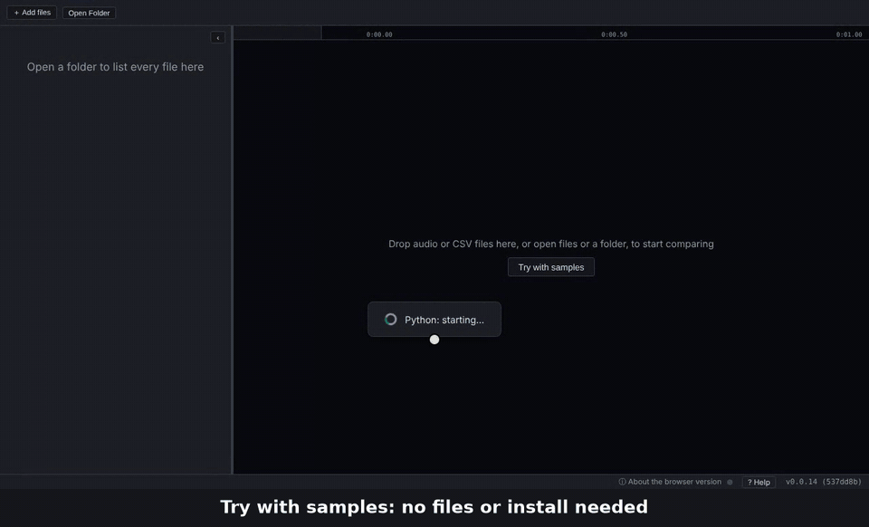
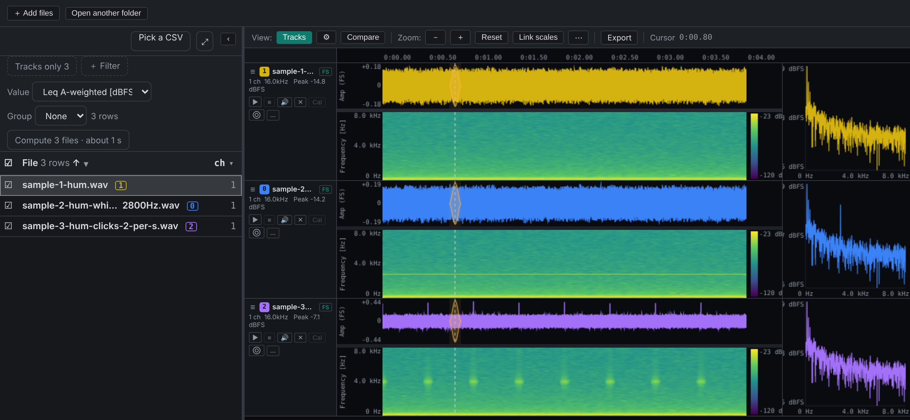
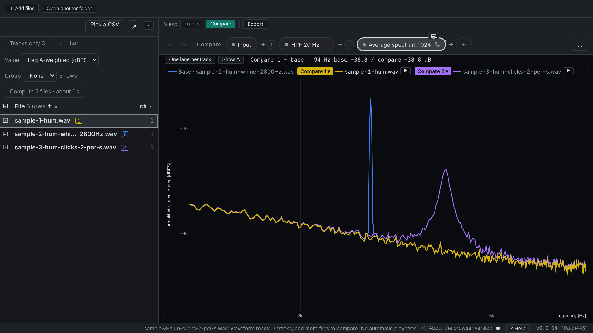

# Audio Wandas Analyzer

**English** | [日本語](https://github.com/kasahart/audio-wandas-analyzer/blob/main/README.ja.md)

**Find what sounds different, then see why.** Line up recordings, listen and look on one timeline, and overlay their spectra and other analyses on the same axes.

**[▶ Try it in your browser](https://kasahart.github.io/audio-wandas-analyzer/)**: press **Try with samples**, no files or install needed. Your audio never leaves your device. For long recordings and calibration, install the [VS Code extension](https://marketplace.visualstudio.com/items?itemName=audio-wandas-analyzer.audio-wandas-analyzer).



*The bundled samples: the same hum three times, one with a 2.8 kHz tone and one with clicks.*

## How it works

1. **Open** files or a whole folder. Every file is listed in a table; tick ☐ to show it as a track.
2. **Listen and look.** Each track shows its waveform over its spectrogram on one timeline, with the spectrum at the cursor beside it. Play, loop and nudge tracks to line them up.
3. **Compare.** Pick a base and up to three recordings to compare (keys `0`–`3`). Their results are drawn over each other, one colour per role: blue for the base; yellow, purple and magenta for the others.
4. **Analyze as a chain.** The step bar is a [wandas](https://github.com/kasahart/wandas) method chain, such as *Input → HPF 20 Hz → Average spectrum*. **＋** adds a wandas operation anywhere in it; click a step to see its result for every recording.
5. **Take it with you.** Export PNG, CSV, WAV or a Markdown / notebook report, or save the chain as a `.recipe.json` that wandas can run on its own.





## Also in the box

- **Many files:** the table shows a value per file (such as A-weighted Leq) to sort, filter and group, and takes an attribute CSV (anomaly scores, conditions…) to narrow down the candidates.
- **Reference track:** transfer function and coherence from one track to the others.
- **Calibration** to Pa, m/s² or V, with levels in dB SPL (VS Code).
- **Bundled recipes**, including loudness and roughness.
- **Formats:** WAV, FLAC, OGG, OGA, Opus, MP3, AIFF, AIF, AU, SND, CAF, W64, RF64 and CSV (first column = time). Playback covers WAV, FLAC, OGG, OGA, Opus and MP3.
- English and Japanese, following your VS Code or browser language. Press **? Help** for the keys.

## Browser or VS Code

| | Browser | VS Code |
| --- | --- | --- |
| Setup | None: open the page | Python 3.11+ |
| Files | Short files (see [Browser limits](#browser-limits)) | Large and long files |
| Calibration | Not available | Available |
| Recipes | Bundled and your own `.recipe.json`; steps that need Python packages the browser lacks do not run | Anything your Python environment can run |

## Get started in VS Code

1. Install [Python 3.11+](https://www.python.org/downloads/) and this extension.
2. Right-click an audio file or folder in the Explorer and choose **Analyze with Audio Analyzer**.
3. If the Python packages are missing, choose **Create .venv and Install**. The extension creates a virtual environment in your workspace and installs them.

If that button does not appear (an untrusted workspace, or a `.venv` already there), or to use an environment of your own, install the packages into it and run **Audio Analyzer: Select Python Environment**:

```bash
pip install "wandas[psychoacoustic,effects]>=0.13.0,<0.14.0" "numpy>=2.0.2" "scipy>=1.13" "soundfile>=0.12"
```

Files and folders can also be opened from the **Audio Analyzer** view in the Activity Bar (or by dropping them on it), or with **Audio Analyzer: Analyze File or Folder**.

## Reference

### Settings

| Key | Default | Description |
| --- | --- | --- |
| `audioWandasAnalyzer.pythonCommand` | unset | Python environment folder or executable used for the backend. Unset: the Python extension's environment, else `VIRTUAL_ENV`, else the first of `py -3`, `python` (Windows) or `python3`, `python` (elsewhere) that runs |
| `audioWandasAnalyzer.cacheMemoryMb` | `1024` | Maximum memory (MB) used to cache loaded audio |

In a workspace you have not trusted, the extension runs in limited mode: analysis works, but `audioWandasAnalyzer.pythonCommand` and `audioWandasAnalyzer.debugFilePath` are read from your user settings only, so a folder's `.vscode/settings.json` cannot choose the program the extension starts. Virtual workspaces (such as a GitHub repository opened in the browser) are not supported, because audio is read from the local file system.

Folder listing skips hidden folders (such as `.git` or `.venv`), `node_modules` and symbolic links to folders, and stops after 50,000 entries; open a subfolder to see the rest.

### Troubleshooting

- **No Python interpreter could be run / was not found:** the message lists each interpreter tried and why it failed. Select the environment where the packages are installed, or set `audioWandasAnalyzer.pythonCommand`.
- **Analysis failed:** open **Output: Audio Wandas Analyzer** and check the Python error.
- **A file does not load:** check that its format is in the list above. M4A is not supported.
- **Large files feel slow:** the waveform is fetched only for the visible range; for spectrograms, try a smaller FFT size or a lower overlap.

### Browser limits

Audio is analyzed on your device and is not uploaded. Display settings are remembered between visits; files, cursor and offsets are not, so select your files again after reloading.

<!-- browser-limits:start (generated by scripts/check-single-sources.mjs --write) -->
| Limit | Browser version |
| --- | --- |
| Formats | WAV, FLAC, OGG, OGA, Opus, MP3, AIFF, AU, SND, CAF, W64, RF64, CSV |
| Per file | Up to 80 MiB; mono or stereo |
| Sample rate | 1–96 kHz |
| Comparison | Up to 8 tracks, 256 MiB of input files and about 17 minutes of 48 kHz stereo audio in total |
| WAV export | Uncalibrated PCM16 audio; up to 32 MiB in total |
<!-- browser-limits:end -->

Use a desktop browser for the full set of mouse controls. Exported notebooks refer to the audio by file name, so place copies of the audio beside the notebook.

## Links

- [Issues and feature requests](https://github.com/kasahart/audio-wandas-analyzer/issues)
- [wandas](https://github.com/kasahart/wandas), the signal-analysis library behind every step
