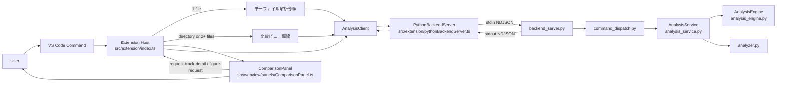
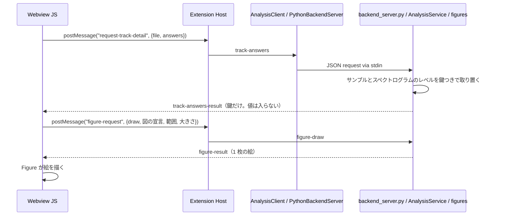

# Audio Wandas Analyzer Architecture

## 概要

このプロジェクトは、VS Code 拡張機能のフロントエンドと Python 製の解析バックエンドを分離した三層構成です。現在のユーザー導線は次の 2 系統に分かれています。

- 単一ファイル解析: ファイルを 1 件選択して即座に解析し、1 トラック状態の ComparisonPanel で確認する
- 比較ビュー: ディレクトリ選択または複数ファイル再選択のあと、対象を絞り込んで順次解析し、複数トラック状態の ComparisonPanel で比較する

各層の役割:

- Extension Host 層: コマンド登録、設定取得、ファイル選択、Python プロセス起動を担当
- Python Backend 層: 音声解析、数値計算、JSON 形式の結果生成を担当
- Webview UI 層: 比較パネル描画、ズームやホバーなどのインタラクションを担当

設計上の主眼は、VS Code 固有処理と信号処理ロジックを切り離し、UI と解析処理を疎結合に保つことです。

## Desktop / static Web の共通境界

Comparison UI と DSP は同じソースを使う。解析コマンドの型・応答検証は
`src/shared/protocol/backendProtocol.ts`、UI から host への型・入力検証は
`src/shared/protocol/panelMessages.ts` に置く。Worker の正常応答も native IPC と同じ
validator を通す。Web の load/unload/clear/export-plan/limits は Worker 専用であり共通コマンド（`transport/command_dispatch.py` の `COMMANDS`）と混同しない。
その応答は `src/webview/runtime/workerProtocol.ts` が検証し、共通コマンドは `parseBackendResult` に渡す。
Web host（`staticHost.ts`）は port 実装と組み立てを持ち、Worker の起動・再読込・再起動・予備 Worker への交代は
`staticWorker.ts`、ソースの一覧・上限・フォルダ鍵は `staticSources.ts`、ダウンロードと ZIP は `staticDownloads.ts`、
選択肢と Recipe 結果の枠は `staticDialogs.ts`、フッターの操作部と Python 表示は `staticFooter.ts` に置く。

- `AnalysisClient` は analyze/detail/slice/range/export/recipe の要求を組み立てる。
  `executeLazyAnalysis` は detail/slice/range の UI 結果へ変換する。host は
  型付き request transport と表示中の calibration/STFT context を提供する。
- `runAnalysisBatch` は逐次処理、`SessionRequests` は世代・request ID・dispose 後の応答排除を担当する。
  Web の clear は世代を進めて再利用し、native Panel dispose は閉鎖する。再生成 Panel は別 session。
- `SourceResults` は結果 collection と owner の参照同一性を管理する。native は借用した directory cache を
  選択解除・detach 時にも保持し、revision 不一致だけを除去する。Web は所有 source の drop/clear 時に
  lease を無効化して Blob を解放する。Worker unload/terminate、許可パス、native 取消は adapter の責務。
- `AnalysisContextPolicy.current/discardStale` は native の校正 store を注入する。
  lazy request の明示 revision（0 を含む）は表示済み context として優先する。analyze は現 store の
  context を使い、一致した stale profile の破棄後だけ1回再試行する。取消 token は初回と再試行で共通。
  Web は policy なしで入力 context を使う。校正 UI/persistence を Web に追加したことにはならない。
  校正 store（revision・変更 listener・書込み順序）は activate（`bootstrap.ts`）が1つ作り、backend の policy、
  `PanelController`、校正コマンドへ渡す。トラックの校正ボタン（`configure-calibration`）も `parsePanelMessage` を
  通り、`PanelController` の port が表示中の結果で store を呼ぶ。校正コマンドは表示 hook で前面の Panel を追うだけで、
  Panel に別の message listener を登録せず、prototype や show メソッドも書き換えない。
- `ComparisonSessionController`（`src/shared/session/`）は panel message の解釈を一度だけ持つ。
  設定保存、再解析の start/update/end 包絡と世代ゲート、lazy 結果への変換と公開判定、
  WAV 区間・レポートの書き出し手順、未対応操作の通知経路はここにある。host は
  `ComparisonSessionPorts` で scope（公開可否）、transport、設定ストア、ダイアログ、
  ソース所有を注入する。native `PanelController` と Web `staticHost` は port 実装だけを持ち、
  同期的な port は同一 tick で backend command に到達する。active source が 0 件の再解析は
  設定保存のみで包絡を送らない。
- `OrderedSelection` は順序・重複排除・再追加の規則を担当する。native の tree による
  パス許可検証を UI 側の選択状態で代替しない。
  native host は Webview が名指ししたパスを `PanelSession.allowsFile`（表示中のトラックか、
  フォルダが列挙した・追加したファイルだけを許す）で確かめてから disk や backend に渡す。
  入口のヘッダの読み取り、比較の走査、WAV 書き出しがこれを通る（`panelController.ts`）。
- `exportWavRegions` は区間計画・順序・衝突しない名前を共有する。sink は書込み先と
  失敗方針を提供する。native は個別失敗後も継続し、Web は予算検証後に失敗で中断する。
- spectrogram 設定は `SpectrogramSettingsStore.get/update` を通す。
  workspaceState と localStorage、校正の realpath と永続化、保存ダイアログと Blob/ZIP は adapter に残す。
- Python の `command_dispatch.py` は検証と service 呼出しだけを持つ。
  `backend_server.py` は native 起動・heartbeat・NDJSON、`browser_service.py` は
  virtual source と Web 上限を担当する。Web 配布物には native transport を含めない。

- Recipe は wandas の `RecipePlan` JSON（`*.recipe.json`）。書き出しメニューの「レシピを開く…」は Webview 内で
  ファイルを読み、`src/shared/recipe/recipeOpen.ts` が手順バーの一本の手順にする（入力 1 つはそのまま、
  基準と応答の channel を `concat_frame` で組にする 2 入力は、その cross-channel step を基準スロットに参照させる）。
  開いた手順は手順バーで組んだ手順と同じく `scan` で各録音に適用し、比較台に描く。結果専用のパネルや backend command は持たない。
- 「レシピとして保存」は webview が下のパネルの内容（スペクトルのファイルと帯域、または基準チャンネルと応答チャンネル）を
  `save-recipe` で送り、共通 session controller が STFT 設定を足して `build-recipe` を呼ぶ。Python 側の `recipe_builder.py` は
  表示中のファイルと同じ形の無音 frame で wandas の処理を実行し、`RecipePlan.from_frame()` で Recipe JSON にする。
  native は保存ダイアログ、Web はダウンロードで `<名前>.recipe.json` を渡す。

校正設定 UI、フォルダ選択、codec の Web 対応範囲は増やしていない。
新しい共通処理は両 host が実際に参照する。host 名による分岐で共通ファイルを膨らませない。

### 共有率の測り方と目標

`python3 scripts/audit-runtime-sharing.py --baseline 277bdd7a9a92b63a6e8820368ca29ea3bb44b745 --output test-results/runtime-sharing.json`
で、基準と作業中の全 production source の到達元・ファイル数・非空行数を比較できる。
型 import と build の明示 root を含む source closure であり、全行実行や機能同等性の割合ではない。
HTML/CSS は所在する TS に含め、tests、vendor、生成物、docs、build/dev tools、設定とデータ asset は除外する。
CI（`.github/workflows/ci.yml`）が shallow checkout でも動く現状監査を実行する（`npm run verify` には入っていない）。

基準は共有 31 / 全体 61 ファイル (50.82%)、非空行 10,394 / 15,960 (65.13%)。
80% は目標であり達成済みではない。native 専用の Python 環境管理、コマンド登録、Panel、
ファイル権限は adapter として残るため、ファイル数での 80% は同じ分母では保証できない。
行数ベースは Recipe の Web 対応と共通 session controller で 80% 近傍に達する。
独立した adapter を合併して数を減らす、共通 file を細分化する、未使用 import を追加する方法は採らない。
率と併せて、同じコマンド変換・区間計画・選択規則を一度の変更で両版へ反映できるかを評価する。

## 全体構成



## ユーザーフロー

### 1. 単一ファイル解析

1 件の音声ファイルを選択し、その場で解析して表示する最短導線です。内部では `runAnalysisBatch`（`src/shared/analysis/analysisCoordinator.ts`、`src/extension/analysisOrchestrator.ts` から呼ぶ）を 1 ファイルで呼び、返ってきた `AnalysisResult` を `AnalysisResultWithError[]` の 1 要素配列として `panelController.ts` が `ComparisonPanel.show()` に渡します。したがって UI 上は比較パネルでも、実際には単一トラックの詳細閲覧として振る舞います。

### 2. 比較ビュー

複数ファイルを対象に解析して、共通タイムライン上で比較する導線です。開始点は 2 通りあります。

- フォルダを選択し、配下の対応音声ファイル群をツリーから選択して対象を確定する
- フォルダを選択し、配下の対応音声ファイル群をツリーから逐次チェックして比較対象を増減させる
- 単一ファイルを開いたあと、ツールバーから別のファイルまたはフォルダを開いて同じパネルを再利用する

ディレクトリ入力では、まず extension 側が `DirectoryTreeNode[]` を構築し、ComparisonPanel を選択モードで開きます。初期状態ではトラックは空です。Webview から返った選択済みファイル一覧を extension 側で再検証したあとに 選択したファイルで `runAnalysisBatch` を呼び、成功トラックと失敗トラックを含む `AnalysisResultWithError[]` を同じ選択モード panel に再注入します。これによりツリーを閉じずに、右側の比較トラックだけを即時更新できます。

## コンポーネント責務

### 1. Extension Host

対象: [src/extension/index.ts](../src/extension/index.ts)（`activate` で各部品を組み立てる）、コマンド登録は [src/extension/extensionContributions.ts](../src/extension/extensionContributions.ts)

責務:

- `package.json` の VS Code コマンド（`analyzeFile`、`analyzeThisTarget`、`analyzeDebugFile`、`selectPythonEnvironment`、`configureCalibration`）を登録する
- 対象の音声ファイルまたはディレクトリを選択または解決する
- 受け取った対象を単一ファイル解析導線または比較ビュー導線へ振り分ける
- Webview から `select-target`、`analyze-selected-files`、`request-track-detail`、`figure-request` を受け取る
- 設定値 `pythonCommand`、`cacheMemoryMb`、`debugFilePath` を読み込む
- 常駐の `PythonBackendServer` を起動し、`AnalysisClient` 経由で解析要求を送る（詳細は 2 節）
- Python は遅延起動する。ウィンドウを開いただけでは環境確認も backend 起動もせず、コマンド・ウェルカムビュー・
  パネルが必要とした時点で `index.ts` の `preparePython` がインタープリターを決め、依存確認と warmup を行う
- `AnalysisClient` から返った `AnalysisResult` を受け取り、失敗時は `error` 付きの結果へ変換して `AnalysisResultWithError[]` に蓄積する
- ディレクトリ指定時は `ComparisonPanel` を選択モードで開き、チェック変更のたびに同じ panel 内のトラック表示を更新する
- 失敗時は VS Code 通知にエラーを表示する

特徴:

- バックエンドとの境界は `AnalysisClient` に限定されている。request ID で応答を対応付ける NDJSON のやり取りは `PythonBackendServer` が受け持つ
- 解析ロジックを TypeScript 側に持たないため、UI 修正と数値処理修正を独立して進めやすい
- 単一ファイルと複数ファイルの差は主に入力本数だけで、描画面は共通化されている

### 2. PythonBackendServer

対象: [src/extension/pythonBackendServer.ts](../src/extension/pythonBackendServer.ts)

責務:

- `python-backend/backend_server.py` を常駐子プロセスとして起動・管理する
- `AnalysisClient` の要求を request ID 付きの改行区切り JSON で送信し、応答を対応する Promise に返す
- ready、heartbeat、started、タイムアウト、取消、終了時の pending request を管理する。command ごとの timeout は、Python が request の実行を始めたと知らせる started から数え、同じファイルの barrier (scan など) の後ろで待つ時間は数えない

同じプロセスで初期解析と遅延解析を扱い、`AnalysisEngine` のファイル・STFT キャッシュを再利用する。

### 3. Python Backend Entry Point

対象: [python-backend/backend_server.py](../python-backend/backend_server.py) / [python-backend/transport/command_dispatch.py](../python-backend/transport/command_dispatch.py)

責務:

- stdin の NDJSON リクエストを検証し、`AnalysisService` に渡す
- `transport/protocol_schema.py` の `COMMANDS` にあるコマンド（analyze、scan、track-answers、figure-draw などの図のサービスの命令を含む）を検証して dispatch する
- request ID 付きの結果または error を stdout に返す
- 起動通知・heartbeat・request ごとの実行開始通知 (started) と stderr の診断を提供する

検証と dispatch は Web の `browser_service.py` からも使う。

### 4. Audio Analyzer

対象: [python-backend/services/analyzer.py](../python-backend/services/analyzer.py)

責務:

- `AnalysisEngine` で読み込み・校正された frame から表示用の結果を生成する
- チャンネル向きの正規化
- ピーク値の算出
- 録音の要約（長さ、サンプリング周波数、チャンネルごとのピークと校正）への整形

設計上のポイント:

- 画面に描く絵はここでは作らない。Tracks の行、カーソルスペクトル、2 本を比べる図は、処理部が全解像度の答え（サンプル、スペクトログラムのレベル、全ビンの線）を鍵つきで取り置き（`tracks_answers.py`）、図のサービス（`python-backend/figures/`）が画面の幅に合わせた 1 枚の絵と読み値をその答えから作る
- チャンネルごとに独立した要約を返すため、多チャンネル音声でも同じ形を再利用できる

### 5. フォルダと依存の向き

対象: [python-backend/](../python-backend/)

責務:

- 入口は `backend_server.py` と `browser_service.py` の 2 つで、`python-backend/` の直下に置く（Python は起動したスクリプトのフォルダから import を探すので、直下に置けば 4 つのフォルダをそのまま見つけられる）
- 4 つのフォルダは一方向にだけ import する：入口 → `transport/` → `figures/`・`services/` → `frames/`。`scripts/check_figure_imports.py`（verify が実行）が、逆向きの import を名前で止める
- 描くために間引いた点（`Drawn`、`DrawnImage`）を作るのは `figures/thinning.py`、送るのは `figures/picture.py` だけ。範囲・読み値・見出し・件数は答え（間引く前）から作る

設計上のポイント:

- 図の絵の間引きは図のサービスの `figures/thinning.py` だけが行う（表示の規則 R2）。フォルダの表と層の説明は [plot-layers.md](plot-layers.md) にある

### 6. AnalysisService / AnalysisEngine

対象: [python-backend/services/analysis_service.py](../python-backend/services/analysis_service.py) / [python-backend/services/analysis_engine.py](../python-backend/services/analysis_engine.py)

責務:

- `AnalysisEngine`: `wandas.read()` で読み込んだ frame と設定別 STFT をメモリ上限付き LRU キャッシュに保持する。ファイル更新時はキャッシュを無効化する
- `AnalysisService`: 初期要約、Tracks の行・カーソルスペクトル・ペアの図の答えの取り置き、領域のピーク、WAV 区間書き出し、Recipe を処理する

### 7. ComparisonPanel

対象: [src/webview/panels/ComparisonPanel.ts](../src/webview/panels/ComparisonPanel.ts)

責務:

- `AnalysisResultWithError[]` を HTML とインラインスクリプトへ埋め込む
- 1 件のときは単一トラック解析ビュー、2 件以上のときは比較ビューとして描画する
- 表示モードは縦積み（stacked）のみ
- 共通タイムルーラー、ズーム、パン、カーソル同期、トラックごとの再生操作を処理する
- 行ごとに `request-track-detail` で答えの鍵を取り寄せ、行の Figure が図のサービスに絵を頼む（`figure-request`）。ズームのたびに、その範囲の絵を頼み直す
- 解析失敗トラックをエラー表示のまま比較対象に残す

設計上のポイント:

- 単一ファイル、ディレクトリ選択、複数ファイル比較のすべてで `ComparisonPanel` に統一されている
- 比較件数に応じてタイトルとレイアウト密度だけが変わり、基本的な描画パイプラインは共通である
- 図を描くのは 1 つの部品（`src/webview/figure/figure.ts`）で、行の図の宣言は `src/webview/charts/trackRow.ts`

### 7.1 入口の表（entry table）

対象: [src/webview/runtime/entryRuntime.ts](../src/webview/runtime/entryRuntime.ts) / [entryTableHtml.ts](../src/webview/runtime/entryTableHtml.ts) / [src/shared/analysis/entryScan.ts](../src/shared/analysis/entryScan.ts)

入口は録音の一覧です。録音を選んで比較へ渡すだけで、解析はしません。レベルやスペクトルなどの答えは持たず、自分では何も数えません（`src/test/entryNoAnalysis.test.ts` が、入口のファイルが送るメッセージと import を確かめます）。`entryRuntime.ts` の `createEntryScreen` は画面の配線だけを持ちます。描き直しは [entryRedraw.ts](../src/webview/runtime/entryRedraw.ts) がまとめ、クリック・キー・変更ごとに 1 回だけ描きます。部品: スロットと役割 [entrySlots.ts](../src/webview/runtime/entrySlots.ts)、ヘッダの読み取り（チャンネル数・長さ・サンプルレート。音は復号しない）と読む時間の見積もり [entryHeaders.ts](../src/webview/runtime/entryHeaders.ts)、諸元表の数値列の分布（図のサービスが数えて描く Figure） [distributionFigure.ts](../src/webview/screens/distributionFigure.ts)、列の絞り込み [entryFilterPopover.ts](../src/webview/runtime/entryFilterPopover.ts)、比較する行の基準（スロット 0 か群） [entryBase.ts](../src/webview/runtime/entryBase.ts)、フォルダのセッション [entrySession.ts](../src/webview/runtime/entrySession.ts)。

フォルダを開くと（VS Code はディレクトリ解析、Web はフォルダ選択）、レーン表示の上に 1 行 1 ファイルの表が開きます。Webview は `entry-open` を 1 回送り、共通 controller が `entry-conditions`（標準の Recipe、保存したセッション、諸元表の CSV）を返します。スキャンは 1 件も走りません。表の列は、ファイル・条件・長さ・サンプルレート・校正の有無で、長さとサンプルレートはヘッダの読み取り（`entry-probe`）から書きます。条件は諸元表から取ります: フォルダ直下（VS Code は 1 つ上も）の CSV/TSV のうち、音源の 50% 以上に対応するものを自動で読み（`src/shared/analysis/entryMetadata.ts`: 区切りはタブとカンマの多い方、音声列 audio_file 等は開いたフォルダ直下からの相対パスで完全一致、ファイル名だけなら候補が 1 つのときだけ、無ければ sample_id 等に拡張子を補う、大小区別、1 音源に複数行なら最初の行、128 列・20 MiB まで）、表を貼る・表にドロップしても同じ規則で読みます。サブフォルダの階層も条件列になります。諸元表もサブフォルダも無いときだけファイル名（`_`/`-` 区切りで最後のトークンの前の 2 つ）から取ります。キーは 0（基準）、1–3（スロット）、Enter（比較へ）、Esc（ファイルツリーへ）。入口が開いている間、レーン表示のショートカットは働きません。

### 7.2 比較台（comparison bench）

対象: [src/webview/runtime/trackStageMode.ts](../src/webview/runtime/trackStageMode.ts) / [trackStageModel.ts](../src/webview/runtime/trackStageModel.ts) / [src/webview/screens/compareOverlay.ts](../src/webview/screens/compareOverlay.ts)

入口の表でスロット（0 が基準、1–3 が比較）に入れた録音が Tracks になり、Enter で比較台が開きます。比較台は、手順バーで選んだ手順の絵を録音ごとに取り寄せ（`compare-scan`。scan は「Recipe の 1 つの手順を 1 つのファイルにかける」だけ）、重ねて描きます。重ね描き、基準の群の中央値、Δ は図のサービス（[python-backend/figures/](../python-backend/figures/)）が 1 枚の絵として作り、画面はそれを描くだけです。基準はスロット 0 の録音、無ければ比較中の録音と同じ群の録音です（`entryBase.ts`）。30 本を超える基準の群は、ボタンを押すまで解析しません。どの図がどの経路で描かれているかは [figure-list.md](figure-list.md) にあります。

### 7.4 手順バー（PR 5）

対象: [src/webview/runtime/stepBar.ts](../src/webview/runtime/stepBar.ts) / [src/shared/recipe/recipeSteps.ts](../src/shared/recipe/recipeSteps.ts)

`stepBar.ts` は状態とイベントの配線だけを持ち、中身は同じフォルダのモジュールに分かれる: `stepBarModel.ts`（StepBarState・scan が走らせるレシピ・チェーンの並び）、`stepLabels.ts`（チップ名と走れない理由）、`stepChips.ts`（チップの行）、`stepMenu.ts`（＋のメニューと絞り込み。打つたびに描き直すのは一覧だけ）、`stepForm.ts`（⚙ のフォームとその検査）、`stepHistory.ts`（↶ ↷）、`stepGestures.ts`（タップ・長押し・ドラッグ）。トラック表示の「ステップ」モードも同様に `trackStageMode.ts` が配線、`trackStageModel.ts` が状態と scan の指定、`trackStagePainter.ts` が描画を持つ。

手順バーは scan の Recipe の手順をチップで並べる。標準の Recipe はホストが `entry-conditions` で送る（`python-backend/recipes/entry-scan.recipe.json`）。⚙ のフォームの項目は `recipeSteps.ts` の `STEP_PARAMS`（wandas の操作の一覧 `WANDAS_OPERATIONS` から作る）。標本化周波数に対して走れない手順のチップは赤くなり、理由を書く（`stepLabels.ts`）。編集した Recipe はフォルダのセッションに残る（`entrySession.ts`）。

### 7.5 報告の出口（PR 6）

対象: [src/webview/runtime/compareReport.ts](../src/webview/runtime/compareReport.ts)

比較台の「報告に」で、1 つのフォルダに 報告.csv、定義.json、`<レシピ名>.recipe.json`、図.png、図.csv を書き出す。報告.csv と 定義.json は言葉だけ（録音、条件、区間、基準、メモなど。列は [docs/plot-contracts.md](plot-contracts.md) の報告の行）で、解析の値の欄は持たない。図.png と 図.csv は、比較台に出ている図を図のサービスが書き出したもの（[figure-list.md](figure-list.md)）。Webview が中身を作り、`save-report-folder` でホストに渡す: VS Code は選んだフォルダの下にフォルダを作って書き、Web はフォルダ名の zip を 1 つダウンロードさせる。

### 8. Figure（図の部品）と図のサービス

対象: [src/webview/figure/figure.ts](../src/webview/figure/figure.ts) / [python-backend/figures/](../python-backend/figures/)

責務:

- 図の宣言（`src/webview/charts/`）を図のサービスへ送り、返った 1 枚の絵を描く。軸の変換、目盛り、軸の名前、読み値の書式、拡大の操作を持つ
- 図のサービスは、絵に載せるものと件数、確定した範囲、描く用の点、読む点、見出しの点を、間引く前の答えから決める

設計上のポイント:

- 画面は絵のほかに値を持たない。読み値と ← / → は図のサービスへの問い合わせで、描いた点からは読まない（表示の規則 R1、R7）
- 設計は [figure-design.md](figure-design.md)、図の一覧は [figure-list.md](figure-list.md)

### 10. Shared Analysis Types

対象: [src/shared/analysis/analysisTypes.ts](../src/shared/analysis/analysisTypes.ts)

責務:

- `AnalysisResult` など Python バックエンドの JSON 契約の型は `python-backend/transport/protocol_schema.py` から `src/shared/protocol/generated/` に生成され（verify が生成物のずれを止める）、ここは再公開するだけ
- `AnalysisResultWithError`、`DirectoryTreeNode`、校正の型など、Extension Host と Webview の境界で共有する残りの型を定義する

設計上のポイント:

- UI 実装から型定義を分離し、表示層の入れ替えや削除が型契約へ波及しないようにしている
- `src/extension/index.ts` と `src/webview/panels/ComparisonPanel.ts` の両方が同じ型を参照することで、単一ファイル解析と比較ビューのデータモデルを統一している

## 実行シーケンス

### Tracks の行の絵（開いたときとズーム時）



## データフロー

### 入力

- ユーザーが選択した音声ファイルパス、またはディレクトリ選択 UI で確定した音声ファイルパス群、または `debugFilePath`
- VS Code 設定値

### 中間データ

- Python 側で `wandas` が返す音声信号オブジェクト
- NumPy 配列に変換したチャンネル別サンプル列
- 鍵つきで取り置いた全解像度の答え（サンプル、スペクトログラムのレベル）と、図のサービスが作る 1 枚の絵

### 出力

Python 側の正常系レスポンスは `AnalysisResult` として解釈し、Extension Host 側では失敗時の `error` を含めて `AnalysisResultWithError[]` に正規化して扱います。

正常系の `AnalysisResult` は概ね以下の構造です。

```ts
interface AnalysisResult {
  filePath: string;
  fileName: string;
  sampleRateHz: number;
  durationSeconds: number;
  channelCount: number;
  sampleCount: number;
  channels: ChannelSummary[];
}
```

各 `ChannelSummary` は以下を保持します。

- ラベル
- Peak absolute value
- 校正とレベルの基準（画面に描く絵は入らない）

この構造により、バックエンドと UI の依存関係は明確で、互いの内部実装を知らなくても境界契約だけで接続できます。

失敗を含む UI 側の結果モデルは以下です。

```ts
interface AnalysisResultWithError extends AnalysisResult {
  error?: string;
}
```

この形により、比較対象の一部だけが解析失敗しても、パネル全体は閉じずに他トラックを表示し続けられます。

## ディレクトリ構成

```text
src/
  extension/
    bootstrap.ts            package.json の main。校正 store とコマンドを作り index.ts を呼ぶ
    index.ts                activate: 各部品の組み立て
    extensionContributions.ts コマンド・エクスプローラーメニュー・Welcome ビューの登録
    analysisOrchestrator.ts 解析要求の発行と進捗表示
    panelController.ts      ComparisonPanel の表示・ディレクトリ選択・結果の再注入
    panelSession.ts         パネルと Webview の間のポートと選択状態
    targetDiscovery.ts      対象ファイル／ディレクトリの選択とツリー構築
    exportFlows.ts          WAV / PNG / CSV の書き出し
    calibrationStore.ts     CalibrationStore: 校正プロファイルの保存・revision・変更通知
    calibrationPanelRuntime.ts CalibrationPanels: 前面パネルへの校正コマンド（configureCalibration）
    folderStore.ts          フォルダ単位のスキャン索引・セッションの保存
    pythonEnvironment.ts    Python 実行環境の検出と依存パッケージの確認
    pythonBackendServer.ts  解析要求用の永続 Python 子プロセス
    backendIpc.ts           NDJSON IPC の要求管理と診断
    analysisRequestError.ts 解析要求の失敗の型
  shared/
    analysis/
      analysisTypes.ts      共有型定義
    utils/
      audioTarget.ts        Webview メッセージ判定・音声拡張子判定
      directorySelection.ts ディレクトリ選択の純粋関数
      startupDebug.ts       起動時デバッグ挙動の判定
      webviewEscaping.ts    Webview 埋め込み文字列のエスケープ
  webview/
    panels/
      ComparisonPanel.ts    単一ファイル表示と比較表示の Webview UI
    charts/                 図の宣言（どの答えを、どの段に）
    figure/                 Figure（図の部品）
    screens/                図を載せる画面
  test/
    *.test.ts               node:test の単体テスト（npm run verify）
    uiSmoke/                Playwright Chromium のスモークテスト（npm run test:ui）
    fixtures/, helpers/     テスト用データと共通ヘルパー
  e2e/
    suite/index.ts          VS Code E2E スモークテスト
python-backend/
  backend_server.py         入口：拡張機能の常駐 NDJSON サーバー
  browser_service.py        入口：ブラウザ版（Pyodide）のサービス
  transport/                通信の形と入口の振り分け
    protocol_schema.py        プロトコルの定義（TypeScript の型はここから生成）
    command_dispatch.py       コマンドの入力検証と dispatch
    figure_answers.py         取り置いた答えを図のサービスに渡す
  figures/                  図のサービス（答えから 1 枚の絵を作る。間引きは thinning.py だけ）
  services/                 走査、解析、取り置いた答え、Recipe
    analysis_service.py       解析コマンドの実装
    scan_service.py           scan: 1 ファイルの区間に Recipe の 1 つの手順をかけ、その値を図のために持つ
    analysis_engine.py        音声 frame と STFT のキャッシュ
    analyzer.py               frame から録音の要約を生成（チャンネルのピークも）
    stage_combine.py          手順の結果を全解像度のまま取り置く
    tracks_answers.py         Tracks の図のために取り置く答えの鍵
  frames/                   wandas の Frame の読み方
    stage_view.py             Frame を読む 1 か所（read_frame）と、手順の結果の説明（describe）
    level_identity.py         レベルが比べられるか（単位・基準値・基準の名前）
    analysis_spec.py          scan と図が共有する固定値（版付き。端の保護、スペクトルの下限、無音の床）
dist/webview/               compile による生成物
  comparisonRuntime.js      比較ビューの runtime バンドル
media/
  debug/
    sine-440.wav            デバッグ用の単一音声ファイル
    (複数 wav)              マルチトラックテスト用
docs/
  architecture.md           本資料
  developer-guide(.ja).md   開発手順
```

## 依存関係

### TypeScript / VS Code 側

- VS Code Extension API
- Node.js `child_process`
- Node.js `path`

### Python 側

- `wandas`: 音声読み込み、FFT、STFT などの信号処理
- `numpy`: チャンネル整形、可視化向け集約、データ圧縮

## 設定と実行境界

プロジェクト設定の主要な境界は以下です。

- `audioWandasAnalyzer.pythonCommand`: Python 実行コマンド
- `audioWandasAnalyzer.cacheMemoryMb`: 常駐 Python バックエンドの音声キャッシュ上限
- `audioWandasAnalyzer.debugFilePath`: デバッグ用音声ファイルまたはディレクトリのパス

この構成により、実行環境の違いは主に Python コマンド解決へ閉じ込められます。

## 例外処理方針

- リクエスト処理中の Python 例外は request ID 付きの error 応答として返す
- TypeScript 側は error 応答、起動失敗、タイムアウト、プロセス終了を対応する要求の失敗として扱う
- JSON 解析失敗も Extension Host で検出し、ユーザーへ通知する

この方針により、UI 層に Python 例外の詳細を持ち込まず、障害点を Extension Host で集約できる設計になっています。

## 拡張ポイント

将来的な拡張は主に次の 3 箇所に集約できます。

1. 解析の演算の追加
   数の答えを出す演算は wandas（無ければ wandas-extras）に足し、Recipe の手順として使う。処理部に計算を足さない（[plot-layers.md](plot-layers.md)）
2. 図の種類の追加
   図の宣言（`src/webview/charts/`）、図のサービス（`python-backend/figures/`）、Figure 部品（`src/webview/figure/`）の順に足す。手順は [figure-kinds-guide.md](figure-kinds-guide.md)
3. コマンド追加
   `src/extension/index.ts` で別の入力導線やバッチ解析導線を定義できる。現状でも単一ファイルとディレクトリの両方を受け付ける

## 現状の制約

- Webview は解析結果を一括注入する方式なので、超大規模データを段階読み込みする構成ではない
- 常駐 backend は要求ごとに処理し、継続的なストリーミング解析には未対応
- 入力フォーマットの取り扱いは現状 `wandas.read()` に依存しているため、README 上の拡張子一覧と実際のデコード対応範囲は Python ライブラリ側の能力に左右される

## 開発時の判断基準

- VS Code API に触れる変更は Extension Host に閉じ込める
- 数値処理や信号処理は Python 側へ寄せる
- UI 用のデータ圧縮はバックエンドで済ませ、Webview には描画に必要な粒度だけ渡す
- TypeScript と Python の境界変更時は、`AnalysisResult` と JSON 出力の整合性を最優先で確認する

## Shared spectrogram GUI kernel (stage one)

The canonical source and synchronization tool live in
[kasahart/wandas-gui](https://github.com/kasahart/wandas-gui).
`src/shared/gui-core` is a commit/hash-pinned MIT source snapshot with LICENSE and
NOTICE. `scripts/sync-gui-core.mjs` is also pinned to that repository; compile
checks source, attribution and tool hashes without contacting the network.
Update the clean canonical checkout, commit it, then run:

```sh
node scripts/sync-gui-core.mjs --from <wandas-gui checkout> --into src/shared/gui-core
npm run verify
```

Insight uses the same source and tool in its own snapshot destination. The
consumer-local package manifest is a source-entry shim, not the upstream build
manifest. Runtime dependencies remain zero. `spectrogramRaster.ts` retains
Analyzer's track mapping, calibrated units/references and legacy interval policy.
The kernel reuses ImageData's buffer; axes, cursor, cache, IPC and DSP stay here.
Physical STFT/group axes and boundary corrections remain separate product work.
