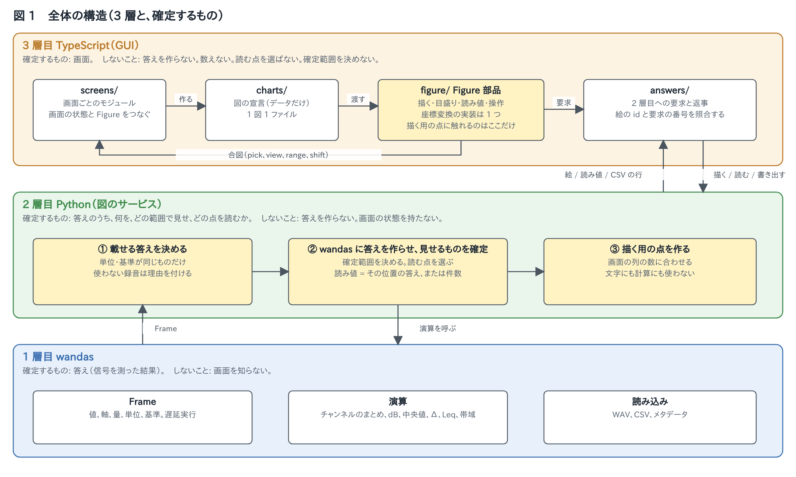
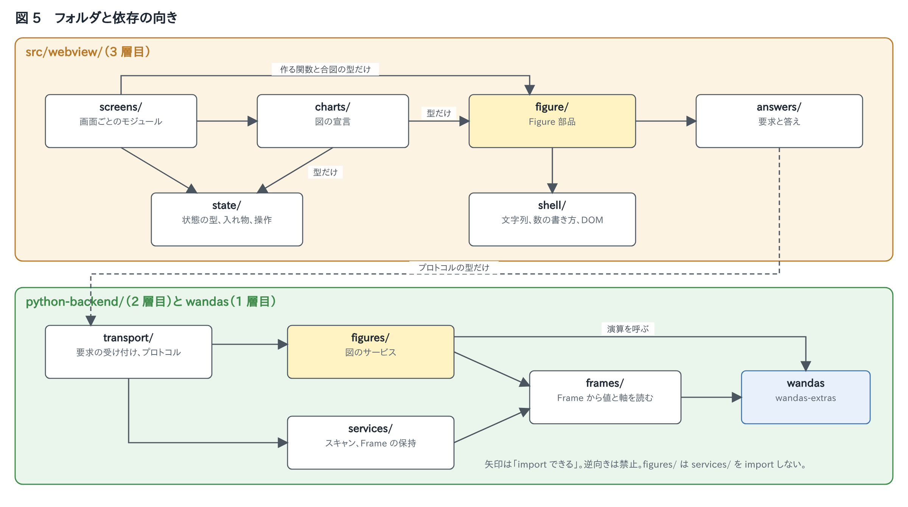

# 図の設計: 3 層の責務と図の構造

アナライザーの図が、なぜいまの形になっているかを書いた設計書です。10 年保守し、開発者が入れ替わる前提で書いています。コードの注釈が「第 N 節」と書くときは、この文書の節を指します。

中心は第 1 節です。アプリを 3 層に分け、各層の責務を決めます。第 2 節より後は、その責務を守るための構造です。第 1 節と食い違う記述があれば、第 1 節が正です。

この設計書が決めるのは、層の責務と、層の間の契約です。画面に何がどう見えるかの規則は [display-rules.md](display-rules.md)、層ごとのファイルの案内は [plot-layers.md](plot-layers.md)、図の種類を足す手順は [figure-kinds-guide.md](figure-kinds-guide.md) にあります。

## 1. 3 層の責務

### 言葉の定義

この設計書では、次の言葉を次の意味だけで使います。

| 言葉 | 意味 |
|---|---|
| Frame | wandas のデータ型（ChannelFrame、SpectralFrame、ChannelFrameSegments など）の実体。値、軸、量、単位、基準を持つ。配列に取り出したものは Frame と呼ばない |
| 答え | 信号を測った結果の値。レベル、スペクトル、Leq、ピークの周波数、中央値、Δ、広がりなど。「どの信号を、どの解析条件で、どの録音の集まりについて測るか」だけで決まる。図の大きさ、指定範囲、ポインターの位置を変えても変わらない。形は 2 つある。Frame の値と、Frame から 1 層目の演算で求めた 1 個の数（Leq、ピークの周波数、波高率）。帯域ごとのレベルの並びや、イベントごとの信号の並びは Frame の値である。どちらの形も量・単位・基準を持つ |
| 表の列の値 | 録音（またはそのチャンネル）ごとに 1 個の値。1 個の数の答え（Leq など）か、利用者の CSV の列の値 |
| 件数 | 録音、イベント、表の行を数えた数。n、使わなかった録音の数、分布図の棒に入る録音の本数。答えではない |
| 読み値 | 利用者が図の上で指したもの（点、棒、セル）について文字に出す値。その位置の答え。分布図だけは、棒ではその棒の件数、棒の下の録音ごとの点と、役割を持つ録音の位置の線では、その録音の表の列の値。この 2 つは印ではなく、読める線として図の宣言に載る。どの線、どの行（録音。表の行がチャンネルごとならそのチャンネル）、どのイベントの値かを示す名前が付く |
| 描く用の点 | 線、棒、熱図を描くためだけに、答えから作った点。画素より細かければ間引く。文字にしない。CSV に出さない。測定、集計、確定範囲の決定、読む点の選択、件数に使わない |
| 配置 | 棒とセルの境界と、分布図で重なる点を上に積む位置。絵に入る。描くときと、読む点を選ぶときの両方が、同じ配置を使う。間引いた点ではないので、描く用の点とは別に扱う |
| 絵 | 1 枚の図を描くために 2 層目が返すひとまとまり。段ごとの軸、確定範囲、描く用の点、配置、件数、目安の線（発火の時刻としきい値。軸上の位置に引くだけで、読めない線。読み値の点に Figure が付ける「印」とは別のもの）、絵の id を持つ。広がりの帯は、四分位の答えを描く用の点の型に入れたもので、点が少なければ間引かない。絵を作るのは 2 層目だけ |
| 図の宣言 | 1 枚の図に、どの答え（または表の列）をどの役割で載せるかを書いたデータ。録音の集まりもここで指定する |
| 段 | 1 枚の図の中の、横軸を共有する 1 つの区画。縦の軸を 1 本持つ。縦の軸は、線と棒の段では値の軸、熱図の段では 2 本目の位置の軸（周波数など。値は色の軸で表す）、分布図の段では件数の軸、概観の帯の段では録音の行。重ね図は 1 段、ペア図はゲイン・位相・コヒーレンスの 3 段、分布図は群ごとに 1 段 |
| 指定範囲 | 利用者がズームや入力で指定した、軸の端の値。軸ごと、端ごとに持つ。片方の端だけを指定してもよい。指定していない端は空。色の軸の端も同じ。3 層目が持つ |
| 確定範囲 | 絵が実際に見せる軸の区間。色の軸も含む。指定した端はその値そのまま、指定していない端は 2 層目が自動で決めた値。絵が持つ。範囲の入力欄に出る数は確定範囲である |
| 合図 | Figure が画面に知らせる出来事。4 種類ある。指したものが押された（pick）、指定範囲を変える操作があった（view）、軸の上の区間が選ばれた（range。Alt+ドラッグ）、トラックが横にずらされた（shift。Shift+ドラッグ） |

本文では「表示範囲」という言葉を使いません。指定範囲か確定範囲のどちらかで書きます。

### 各層の責務

層は「何を確定するか」で分けます。

| | 1 層目 | 2 層目 | 3 層目 |
|---|---|---|---|
| 実装 | wandas（足りない演算は wandas-extras） | Python（図のサービス） | TypeScript（GUI） |
| 確定するもの | 答え | 1 枚の絵。何を載せ、どの範囲で見せ、どの点を描き、どの点を読むか | 画面 |
| 入力 | 信号、解析条件、録音の集まり | 答え、表の列の値、図の宣言、指定範囲、図の大きさ、ポインターの位置 | 絵、読み値、表の行、利用者の操作 |
| すること | 読み込み。信号処理。チャンネルをまとめる。dB にする。録音をまたぐ中央値、四分位、広がり。Δ。Leq、ピーク、帯域。単位の変換 | wandas の演算を呼ぶ。載せるものを決めて数える。確定範囲を決める。描く用の点を作る。読む点を選ぶ。見出しに出す点を選ぶ | 描く。値と画面の位置を変換する。目盛りを置く。文字にする。操作を受ける。画面の状態（指定範囲、選択、役割）を持つ。要求を送り、古い返事を捨てる |
| しないこと | 画面を知らない | 答えを自分で計算しない（1 層目の演算を呼び直すのはよい）。画面の状態を持たない | 答えを作らない。数えない。読む点を選ばない。確定範囲を決めない |

3 層目について 2 点を補います。

- 矢印キーも、押すたびに 2 層目に聞きます。3 層目は、選んでいる点の名前（線の id、録音の鍵、答えの版、点の番号）と進む数を送り、2 層目が次の点を返します。3 層目は前後の点を取り置きません。
- 文字にするときの丸めは 3 層目の仕事です。丸めた文字を数に戻して使いません。指定範囲の端を作るのは 3 層目で、作り方は表示の規則 R9 のとおりです（`figure/fieldWindow.ts`）。入力欄、ドラッグ、ホイールのどの経路も、同じ操作から同じ端になります。契約として決めるのは 1 つだけです。2 層目は、受け取った指定範囲の端をそのまま使い、丸め直しません。

### どの層に書くかの決め方

処理を書く前に、その処理の**結果**について次の 3 つを上から順に問います。最初に「はい」になった層に書きます。

1. 結果は答えか。つまり、測定結果として文字や CSV に出す値、または後の解析の条件に使う測定値（トリガーの初期値にする区間のピークなど）で、図の大きさ、指定範囲、ポインターの位置を変えても同じ値か。はい → **1 層目**
2. 結果は、1 枚の絵（または同じ集まりを使う表や書き出し）のために、答えや表の列の値から決めるものか。決めるものは、載せるものと件数、確定範囲、描く用の点、読む点、見出しに出す点の 5 つ。はい → **2 層目**
3. どちらでもない → **3 層目**

問 1 について 3 点を補います。

- 解析の時刻を決めるカーソルと、測る区間は、解析条件です。図の上で動かしますが、読み値を指すポインターや指定範囲とは別のものです。カーソルの位置のスペクトルは、その時刻を解析条件とする答えです。

- 録音の集まり（どの録音の中央値か）は、画面の状態から図の宣言に書かれます。集まりを選ぶのは 3 層目、その集まりの中央値を作るのは 1 層目です。絞り込みや役割を変えると中央値は変わりますが、それは入力が変わったからで、答えであることは変わりません。
- 確定範囲の端は、拡大していない全体の表示でも答えではありません。測定結果として読む値ではなく、図を見せるための値だからです。問 2 で 2 層目になります。

2 層目は計算をしてよい層です。ただし結果は答えではありません。2 層目がしてよい計算は次の 5 種類だけです。それぞれの規則は第 5 節に書きます。

| | 2 層目がしてよい計算 | 中身 | 結果の扱い |
|---|---|---|---|
| ア | 載せるものを決めて数える | 量・単位・基準がそろっているかを調べ、載せる集まりを決める。さらに軸がそろっているかを調べ、中央値と Δ に使う集まりを決める。n、使わなかった数と理由。分布図の棒に入る録音の本数 | 件数になる |
| イ | 確定範囲の端を決める | 答えの最小と最大を探す。切りのよい値に広げる。熱図の色の幅 | 絵の確定範囲になる |
| ウ | 描く用の点を作る | 線は列ごとの最小と最大。熱図は種類ごとのまとめ方。欠けた区間の切れ目 | 描く用の点になる |
| エ | 読む点を選ぶ | ポインターからの画面上の距離、棒やセルに入っているか。選んでいる点から進んだ先の点。データの刻み | 選んだ点の答えが読み値になる。距離は捨てる |
| オ | 見出しに出す点を選ぶ | 選び方は 2 つあり、図の種類で決まる。確定範囲の中で Δ の絶対値が最大の点（Δ の図の見出し）。全帯域の中から、見出しに出す帯域と Δ が最大の帯域（しきい値との比較。報告と、固定した Δ の行）。画面、PNG、CSV のどれに出すときも同じ関数 | 点の名前を返す。帯域の図では、見出しの帯域の隣で薄く描く帯域の名前も返す。絵や CSV には、その点の答えを丸めずに入れる |

5 種類のそれぞれが受け取るものと返すものを決めます。これ以外の形の関数は 2 層目に置きません。

| | 受け取るもの | 返すもの |
|---|---|---|
| ア | 答えの量・単位・基準・軸、表の列の値、合わせる先。棒の本数を数えるときは、区画の境界と選ばれた範囲も | 2 つの集まり（載せる集まりと、中央値・Δ に使う集まり。それぞれ、使う鍵、使わない鍵と理由、件数）、棒ごとの本数 |
| イ | 答え（分布図では表の列の値、棒ごとの本数、配置が積んだ点の段数）、範囲に入れておく目安の線の位置（しきい値）、指定範囲 | 確定範囲 |
| ウ | 答え（分布図では表の列の値）、確定範囲、枠の幅と高さ | 描く用の点（`Drawn` 型）と配置 |
| エ | 答え（分布図では表の列の値と棒ごとの本数）、配置、確定範囲と、次のどれか。ポインターの位置と縮尺。点の名前と進む数。点の名前（線の id、行の鍵、イベントの番号、軸上の位置） | 点の名前（線の id と点の番号。熱図では行と列の番号）。名前で探して見つからなければ「点がない」 |
| オ | 答え、しきい値。範囲の中で選ぶ場合だけ確定範囲も | 点の名前。絵には、読み値と同じ形（点の名前、軸上の位置、データの刻み、答え）で入れる |

絵を組み立てる処理（軸の名前、校正の言葉、目安の線、見出しを絵に入れる）は、計算ではなく詰め替えです。算術をしません。分布図では、5 種類を次の順に呼びます。載せる値を決める（ア）、値の軸の確定範囲（イ）、区画の境界と点の位置（ウ）、棒ごとの本数（ア）、件数の軸の確定範囲（イ。棒ごとの本数と、ウが積んだ点の段数から決める。イは配置を作り直さない）。

帯域へのまとめのように、同じ名前の処理でも層は結果で決まります。1/3 オクターブ帯域のレベルは答え（1 層目）で、スペクトログラムを対数の帯域にまとめて描くのは描く用の点（2 層目）です。

これ以外の計算（平均、中央値、四分位、広がり、差、dB への変換、帯域へのまとめ、チャンネルのまとめ、単位の変換）を 2 層目に書いてはいけません。必要になったら 1 層目の演算として足します。ウの中の「熱図のまとめ方」は、まとめるセルの中の最大の値を取ります（レベルと粗さは最大、Δ とケプストログラムは符号を保ったまま絶対値が最大の値）。短い音が平均で薄まって消えないようにするためです。描く用のセルは答えのセルのどれか 1 つの値そのもので、新しい数を作りません。結果は描く用の点で、文字にも CSV にも出ません。

描く用の点を文字や CSV に出したくなったら、その値を答えとして 1 層目に足します。描く用の点をそのまま文字にしません。

### 判定の例

| 処理 | 層 | 理由 |
|---|---|---|
| dB への変換と −300 dB の下限。チャンネルをまとめる。中央値。四分位。Δ。Leq。波高率 | 1 | 測定結果。画面に依らない |
| 群の広がり（MAD の 3 倍 × 1.4826） | 1 | 測定結果。画面に依らない |
| ピークの周波数（スペクトルの最大の点） | 1 | 測定結果。最大を「選ぶ」処理だが、結果で判定する |
| 1/3 オクターブ帯域のレベル。通過帯域の外を値なしにする | 1 | 測定結果 |
| 位相をラジアンから度にする | 1 | 測定結果の単位の変換 |
| 単位・基準が同じ答えだけを図に載せる。n、使わなかった数 | 2（ア） | 絵に載せるものを決めて数える |
| 分布図の棒に入る録音の本数 | 2（ア） | 表の列の値から、絵のために数える |
| 自動の範囲。切りのよい端（R9）。熱図の 100 dB の幅 | 2（イ） | 絵の確定範囲 |
| 線の間引き。熱図の画素ごとのまとめ。概観の帯で録音の行を束ねること | 2（ウ） | 描く用の点。読み値には使わない |
| 読む点の選択（R7、半径 20 px）。矢印キーで進んだ先の点 | 2（エ） | 絵の上で読む点を決める |
| 確定範囲の中の Δ の最大の点。見出しの帯域 | 2（オ） | 答えの中から見出しに出す点を決める。値は作らない |
| 値を画面の位置に変換する。目盛りの位置と文字 | 3 | 確定範囲と図の大きさから決まる。答えを入力にしない |
| 桁をそろえて文字にする | 3 | 表示の形式 |
| 矢印キーで前後の点へ進む | 3 が頼み、2（エ）が答える | 3 層目は進む数を送るだけ。点を取り置かない |
| 要求と返事の照合、再試行 | 3 | 要求の管理 |
| 指定範囲、選択、役割、再生位置を覚える | 3 | 画面の状態 |
| CSV: どの答えを出すか / ファイルの形式 | 2 / 3 | 出す答えは 2 層目が決め、文字にするのは 3 層目 |
| PNG: 描く用の点 / 描画 | 2 / 3 | PNG の大きさに合わせた点は 2 層目が作り、描くのは 3 層目 |

### 答えを作る順序

答えの意味を変えないために、演算の順序を仕様にします。順序は量の種類で違うので、種類ごとに書きます。

| 量の種類 | 例 | 録音ごとの値 | チャンネルをまとめる | 録音をまたぐ中央値 | Δ |
|---|---|---|---|---|---|
| レベル | スペクトル、1/N オクターブ帯域、スペクトログラム | wandas が dB にする。無音は wandas の下限（振幅 1e-12。基準 1 なら −240 dB）になる | チャンネルごとの dB の値をパワーに戻して平均し、dB に戻す | dB の値で、点ごとに取る | dB の値の差（比較 − 基準） |
| すでに dB の時系列 | 音圧レベル、dB の RMS の推移 | dB にし直さない。下限もかけ直さない | 同上（パワーの平均） | dB の値で取る | dB の値の差 |
| 線形の量 | ラウドネスなどの指標、ケプストラム、ケプストログラム、粗さ | その量の値のまま | 算術平均 | その量の値で取る | その量の値の差 |
| 時間信号 | 音そのもの | サンプルの値のまま。レベルにしない | サンプルごとの算術平均 | 先頭をそろえた共通の長さで、サンプルごとに取る | サンプルごとの差 |
| 2 チャンネルの組の量 | コヒーレンス、相互相関、伝達関数、クロススペクトル | 決まった 1 組（`_cross_pair`）だけを使う。コヒーレンスと相互相関は値のまま、伝達関数とクロススペクトルはレベル | まとめない | 上の行の、その量の種類と同じ | 同じ |
| トリガーのイベント | イベントごとの時間信号 | イベントごとに、チャンネルを算術平均する | （左に含む） | イベントの間は算術平均（wandas がどのイベントも同じ長さで切る。区間の端ではみ出すイベントは作らない）。録音をまたぐ中央値は、その平均どうしで、サンプルごとに取る | 取らない。2 つの録音のイベントは重ねて見せるだけ |

すべての種類に共通の決まりは次のとおりです。

- 計算は入力の精度で行います。16 bit、24 bit、float32 の録音は float32 で持ちます（値を正確に表せ、ブラウザ版のメモリを抑えられる）。校正済みの録音と CSV は float64 です。スペクトログラムだけは、計算の直前にブロックごとに float64 にします。中央値、Δ、四分位は float64 で計算します。float32 の隣り合う 2 つの値の中央値は、その間の値になります。校正の有無によるレベルの差は最大 0.000036 dB で、表示の桁には出ません。
- 中央値は、どれか 1 本でも値が欠けている点では値なし（NaN）です。偶数本のときは、まん中の 2 つの値の算術平均です。レベルでは dB の値どうしの平均になります。中央値に入れる録音の集まりは、2 層目の計算アが決めます。単位・基準・軸の合わない録音は外し、残りで取ります（仕様 2）。
- 1 本だけの基準には中央値を取りません。その 1 本の値がそのまま基準です。
- dB の値が NaN か −inf になった点は −300 dB に、+inf になった点は +300 dB に置き換えます。かけるのは、録音ごとの dB の値と、パワーの平均の後です。すでに dB の時系列には、どちらもかけません。wandas の dB が先に下限をかけるので、実際の録音で −300 dB が出るのは NaN と ±inf のときだけです。走査の値だけは、NaN を誤りとして先に断ります。
- 四分位は線形に補間します（位置 = (本数 − 1) × p）。3 本未満の群には出しません。どれか 1 本でも値のない帯域には出しません。
- 時間信号を録音をまたいでまとめるのは、開始の位置のずれが 0.5 サンプル以内で、標本化周波数と単位・基準が同じときだけです。ずれは補正せず、サンプルの番号で引きます。共通の長さは、いちばん短い録音の長さです。0.5 サンプルちょうどの判定は、浮動小数で揺れないように整数のサンプルで行います。
- 群の広がりは、帯域ごとに、値のない録音を除いて「中央値からの差の絶対値の中央値 × 1.4826 × 3」です。値のある録音が 2 本未満の帯域には出しません。基準が 1 本のときは、同じ群のほかの録音で取ります。1.5 dB の下限は広がりの値に入れません。見出しの帯域を選ぶときのしきい値として、2 層目（計算オ）が使います。広がりが出ない帯域と、3 本未満の群では、オは 1.5 dB をそのまま使います。
- wandas の Frame 同士の引き算は振幅の差です。レベルの Δ とは別の演算なので、置き換えに使いません（差は最大 240 dB になります）。
- カーソルの位置のスペクトルは、録音の端では窓を内側へ押し込みます。wandas の STFT のように外側を 0 で埋めません。
- 区間のピークは、区間の両端を含みます。
- Δ のピークが同点のとき、時間信号は正の値を、スペクトルとケプストラムは先の点を取ります。
- ペアのスペクトルは、片方が無音ならゲインは値なしです。
- 累乗の後の単位（Pa²）、指標の単位（sone、asper）、量が振幅かパワーかは、wandas が持つようになるまで、アプリの 1 か所（`frames/`）で補います。

この表と違う値が見つかったら、値を黙って変えません。どちらが正しいかを確かめてから、この表を直します。

### この設計で決めた仕様

前の作り（v0.0.15 まで）から、仕様を次の 8 点で変えました。コードとテストの注釈が「仕様 N」と書くときは、この表の番号です。

| | 決めたこと | 前の作りとの違い、残したもの |
|---|---|---|
| 1 | 線を描く順は、図の宣言に書いた順に固定する。後に描いた線が上。図の宣言は、基準の群の線（録音の並び順）、基準の中央値、比較 1、2、3 の順に書く。イベントは番号順。ホバーした線だけは最後に描く。スペクトルの重ね図は基準の群を 1 本ずつは描かず、中央値だけを描く（1 本ずつ描くのは時間信号だけ） | 前は「静かな線が上」で、拡大のたびに並べ直した。そのための線ごとのレベルの区間の計算と送受信は無い。読む点の選択は描く順に依らない（第 5 節） |
| 2 | 1 つの段の値の軸は、1 つの単位・基準（値と名前）だけ。合わせる先は、比較の図では比較対象の録音（複数あれば比較 1。比較 2、3 が合わなければ載せず、理由を書く。比較 1 の答えがもう得られない（失敗・大きすぎる・チャンネルがない）ときは、画面が知っているその録音の単位・基準、それも無ければ役のある録音のいちばん多いもの）、比較対象のない図ではいちばん多い単位・基準（同数なら表で先のもの）。合わない録音は載せず、理由と数を書く | 前は単位・基準が違うレベルを 1 枚に載せ、右に第 2 の軸を出した。右の軸は無い。段が違えば単位は違ってよい（ペア図）。校正済みと未校正は同じ軸に載り、混ざった中央値は未校正と書く |
| 3 | 入口の表は、群の中央値との Δ の列と、いちばん差の出る帯域の自動選択を持たない | 仕様 8 に含まれる（入口の表は解析値そのものを出さない） |
| 4 | Web 版は、長い計算（走査、手順の再計算、書き出し）の最中は読み値を「計算中」と出す。その間は点を指すクリックも実行しない。計算の前に送った読む要求の返事が計算中に届いても、使わない。計算が終わると、ポインターの位置で読み直す（第 6 節） | 前は Web 版も長い計算の最中に読み値を出した。VS Code 版は変えていない |
| 5 | トリガーのイベントごとの時間信号は、ほかの答えと同じ鍵（録音、手順、イベントの番号）で引き、同じ手順で描いて読む | 前はイベント専用の重ね順と読み取りの分岐があった。イベントの番号、イベントごとの線、トリガーからの相対時間、発火の時刻、使わなかったイベントはそのまま |
| 6 | 外れ値の判定はしない。利用者が分布図から読み取る | 群の広がり（四分位の帯、MAD の 3 倍）と、それを使う見出しの帯域の判定はある |
| 7 | 分布図は表の列の値をそのまま描く。新しい答えを作らない。ほかの図と同じく 2 層目が絵と読み値を返す | 前は分布図が中央値の印を持ち、区画、本数、範囲を TypeScript が計算した。古い値と単位・基準が違う値を載せない保護、群分け、録音とチャンネルの数え分け、範囲の選択と範囲に入る本数、棒の下の録音ごとの点、役割を持つ録音の位置の線、本数の読み値はそのまま |
| 8 | 入口は解析しない。入口の表は、ファイルの情報（長さ、標本化周波数、チャンネル数、校正）と、利用者の表（CSV）の列だけを出す。分布図は、表にある数の列を利用者が選んで描く。解析は比較台で、選んだ録音に、利用者が選んだ手順でだけ行う。報告は、比較台に出ている段の答えから作る | 前は録音を入れると決まった手順で全部の録音を自動で走査し、Leq、ピークの周波数、波高率、帯域のレベル、平均スペクトルを作って、入口の表の値の列、概観の帯、入口の比較の図に出した。それらは無い。条件の列、群分け、スロットと役割、メモと除外、表との突き合わせ、手順バーのプリセットはそのまま |

**設計の帰結として決まる振る舞い**

8 つの仕様のほかに、この設計から 3 つの振る舞いが決まります。

| 前の作り | この設計 | 理由 |
|---|---|---|
| ポインターの近くの点は webview が取り置いていて、その中を動く間は往復せずに読む。取り置きの外へ出ると、届くまで読み値は空（R7） | 読み値は動くたびに 1 往復する。届くまでは、前の読み値と印を出したままにする。空にしない | 読む点を選ぶ規則を 2 層目の 1 か所にするため。空にすると、動かすたびに読み値がちらつく |
| ズームや大きさの変更の直後は、手元の粗い点を新しい範囲で描き、細かい点が届いたら描き直す。待つ間の読み値は空 | 描き方は同じ。指定範囲か大きさだけが変わったときは、新しい絵が届くまで、前の絵の描く用の点を新しい指定範囲に写して描く（座標の変換だけ）。指定していない端は前の確定範囲のまま。待つ間は読み値と印を消し、読む要求も送らない | 図が固まって見えないようにするため。前の絵の点から読むと、古い範囲で選んだ点を読むことになるので、読むのは新しい絵が届いてからにする |
| 点を押して読み値を待っている間に図が描き直されるか、図が取り除かれても、待っていたクリックをそのまま実行する | 世代が進むか Figure が破棄されたら、待っていたクリックは実行しない | 古い絵の上で押した点を、新しい絵の上で実行しないため |

## 2. 責務を守るための決まり

第 1 節の責務は、人の注意ではなく仕組みで守ります。仕組みが保証する範囲も書きます。

| 決まり | 内容 | 守らせる仕組み | 仕組みが保証しないこと |
|---|---|---|---|
| A. 答えは 1 層目の演算の結果だけ | 2 層目に書いてよい計算は第 1 節の 5 種類だけ | `figures/` の中で numpy を使えるファイルを、5 種類の規則のファイルに限る（import の検査） | 規則のファイルの中に答えの計算を書くこと。これはレビューと、わざと誤りを入れるテスト（第 9 節）で止める |
| B. 描く用の点は答えと型を分ける | Python では、間引いた配列は `Drawn` 型に包む。`Drawn` を作れるのは間引きのファイルだけ。受け取れるのは絵を組み立てるファイルだけ。確定範囲、読む点、見出し、件数の関数は `Drawn` を受け取らない。TypeScript は描く用の点の型を `figure/` の外に公開しない | Python は型検査（このリポジトリが verify で使っている検査器をそのまま使う）と、`Drawn` の名前が出てよいファイルを調べる短い検査。TypeScript は ESLint | 型を外して配列を取り出すこと。取り出せる関数を 1 つに限り、検査で呼び出し元を限る |
| C. 1 図 = 1 部品、絵を作るのは 2 層目だけ | 描く、目盛り、読み値、クリック、キー、ズームは Figure 部品が受け持つ。個々の図は配線を書かない。3 層目は絵を作らない | Canvas とポインターのコードは `figure/` の中だけ（ESLint） | |
| D. 1 つの規則の実装は 1 か所 | 同じ規則を 2 つの言語や 2 つの経路に書かない | レビューと、両方の言語が読む共有のテストデータ | |
| E. 返事は要求と結び付ける | 返事は絵の id と要求の番号を持つ。Figure は、いまの絵への、いちばん新しい要求への返事だけを使う | 順序を入れ替えるテスト | |
| F. 依存は一方向 | フォルダが層を表す。import できる向きを決める | ESLint の標準の規則と、Python の短いスクリプト | ファイルの置き場所だけを見る。中身は見ない |
| G. 正しさはテストで守る | 答えの分かっている信号のテスト、画面上の位置のテスト、本物の通信を通すテスト、わざと誤りを入れるテスト | verify | |

この決まりの対象は図です。音の再生（`audioFade.ts` など）は対象外です。Figure の座標変換が対数を使うことは、値と画面の位置の変換なので 3 層目の仕事です。

データの流れを追う検査器は持ちません。B の型と短い検査（`scripts/check_figure_imports.py`）は「名前と import」を見るもので、わざと型を外す書き方は止めません。値そのものは、図のサービスのテストが、全データと描く点が違うデータで確かめます。

## 3. 全体の構造



前の作りとの違いは 3 つです。

- **答えを作る処理が 1 層目に集まる。** 中央値、Δ、四分位、広がりを TypeScript に書きません。
- **見せ方を決める処理が 2 層目に集まる。** 読む点の選択、間引き、切りのよい端、分布図の区画と本数は、図のサービスにあります。
- **図ごとの配線がない。** 配線は Figure の中の 1 か所です。間引いた点を受け取れるのは `figure/` だけです。

この設計が足したのは新しい層ではありません。図を作る側が、答えの計算、見せ方の決定、配線をもう一度書ける余地を閉じています。

## 4. Figure 部品（TypeScript）

Figure は 3 層目の部品です。1 枚の図の描画と操作をすべて受け持ちます。

図を作る側が書くのは図の宣言だけです。図の宣言はデータだけでできていて、関数を入れません。図の宣言に書けるのは、載せるもの（鍵、集まり、役割）、段、図の種類だけです。「この図だけはこう計算する」という指定を足したくなったら、それは 5 種類の計算の規則を変える話なので、先に第 1 節と第 5 節を直します。

```ts
// 図の宣言の例（簡略）。比較台の重ね図。実物は src/webview/charts/ にある。
export const compareOverlay = (s: CompareInputs): FigureSpec => ({
    lanes: [{
        kind: 'lines',
        lines: [
            { id: 'base', of: { median: s.baseKeys }, role: 'base' },
            ...s.compare.map((c, i) => ({ id: c.path, of: { key: c.key }, role: `compare${i + 1}` })),
        ],
    }],
});
```

画面は図の宣言と指定範囲を Figure に渡し、Figure が出す合図を受けて状態を変えます。Figure は画面の状態を知りません。

```ts
// 画面の側の例（簡略）。実物は src/webview/screens/ にある。
figure.show(compareOverlay(inputs), state.compare.view);
figure.on('view', view => dispatch(setCompareView(view)));      // ズーム・パン・範囲入力
figure.on('pick', read => {                                      // クリック
    if (!read.event) return;
    dispatch(toggleEvent(read.event));
    return () => dispatch(toggleEvent(read.event));             // 取り消す関数。2 度押しで Figure が呼ぶ
});
figure.on('range', range => dispatch(setLoopRange(range)));    // Alt+ドラッグ
```

| 決めること | 内容 |
|---|---|
| 段（lane） | 1 つの Figure は 1 段以上を持ち、段は横軸を共有します。値の軸と座標変換は段ごとです。1 つの段の値の軸は 1 つの単位・基準だけを持ちます。段が違えば単位は違ってかまいません。段は id を持ち、読む要求と読み値に付けます。ペア図の 3 段、分布図の群ごとの行、トラックのレーンはこれで表します |
| 連動（link） | 別々の Figure が横軸の指定範囲とカーソルの位置を共有するときは、画面が同じ link を両方に渡します（主スペクトルとペア図など） |
| 生成から破棄まで | 作る、図の宣言・指定範囲・大きさが変わったら世代を進めて描き直す、破棄。破棄するときは持っている絵をすべて手放します。細かい決まりは第 6 節です |
| 合図 | pick（押された。画面は取り消す関数を返せる）、view（指定範囲を変える操作）、range（Alt+ドラッグで選んだ軸上の区間。分布図の範囲の選択、波形のループ区間）、shift（Shift+ドラッグでトラックをずらした量）。Figure は合図を出すだけで、状態を変えません |
| クリックと 2 度押し | 第 6 節の「読み値とクリック」のとおり |

Figure が受け持つことと、受け持たないことを分けます。

| Figure が受け持つ | Figure がしない（持ち主） |
|---|---|
| 値と画面の位置を行き来する座標変換。実装は 1 つで、段ごとに 1 つ作る。その段の線・目盛り・印・ズームの箱・範囲入力がすべてこれを使う。読む要求に付ける縮尺もここから出す | 確定範囲を決めること、目盛りの種類を決めること（図のサービス） |
| 絵を描くこと。線・棒・熱図・点・波形の帯（最小と最大の間を塗る）の 5 種類 | どの点を描くか、どう間引くか（図のサービス） |
| ポインター・クリック・矢印キー・ホイール・ドラッグを受け取り、合図にすること | どの点を読むか選ぶこと、数えること（図のサービス） |
| 目盛りの位置と文字、軸の名前の言葉、数の桁と言語に合わせた書き方 | 軸の名前の元になる量・単位・基準・校正（図のサービス） |
| 計算中・失敗・値なしの表示。どの図でも同じ | 要求の鍵・鮮度・再試行（`answers/`） |
| 図の中の状態（ホバー中の点、ドラッグ中の箱） | 指定範囲、選択、役割など画面をまたぐ状態（画面の状態） |

画面用の図と、レポートの PNG 用の図は同じ Figure です。大きさが固定で操作を受けないだけで、別の経路は作りません。レポートのページの組み立て（複数の図や表を 1 枚に並べること）は Figure の外です。

分布図も、ほかの図と同じく図のサービスが絵と読み値を返します。図の宣言には、表の列と群分けを書きます。利用者の CSV の列は、版つきの鍵で指定します（第 5 節）。

## 5. 図のサービス（Python）

図のサービスは 2 層目の本体です。wandas を操作し、1 枚の絵を確定します。答えを作りません。受ける要求は 5 種類です。

| 要求 | 渡すもの | 返るもの |
|---|---|---|
| 描く（draw） | Figure の id、図の宣言、指定範囲（なければ空）、範囲の選択（分布図で利用者が選んだ値の区間。ズームの指定範囲とは別の入力で、本数の数え分けにだけ使う。なければ空）、枠の幅と高さ（CSS ピクセル）、Figure の世代、要求の番号 | 絵。中身は、絵の id、データの id、段ごとの軸（段の id、量・単位・基準・校正、目盛りの種類、確定範囲）、線ごとの描く用の点（軸上の値）、棒とセルの境界、棒ごとの本数、目安の線、見出し（点の名前、軸上の位置、データの刻み、その点の丸めていない答え）、使った録音と n、使わなかった録音と理由。Figure の id、世代、要求の番号をそのまま返す。または「大きすぎる」「計算中」「失敗」 |
| 読む（read） | Figure の id、絵の id、要求の番号と、次のどれか。（a）段の id、ポインターの位置（軸上の値。横と縦）、縮尺（横と縦）。（b）選んでいる点の名前（線の id、録音の鍵、答えの版、点の番号。熱図では行と列の番号）と、進む数（符号つき。熱図では上下も）。矢印キーのたびに送る。（c）点の名前（線の id、行の鍵、イベントの番号、軸上の位置）。描き直しの後に、キーで選んでいた同じ点を読み直す。いちばん近い点では代用せず、名前が合う点だけを返す | 絵の id、要求の番号、読み値（段の id、線の id、点の番号、軸上の位置、答え・表の列の値・件数のどれか、データの刻み（横と縦）、録音の鍵、イベントの番号、発火の時刻、使わなかったイベントかどうか）。または「値なし」「線の外」「点がない」（(c) で名前の合う点がない）「絵がない」「計算中」「失敗」 |
| 書き出す（export） | 図の宣言、指定範囲、範囲の選択、データの id | CSV の行。列ごとの量・単位・基準と、答え。使った録音と n、使わなかった録音と理由、見出しも、描く要求と同じものを返す。間引かない。データの id が合わなければ「絵がない」 |
| 手放す（release） | Figure の id | なし。その Figure のための取り置きを捨てる |
| 数える（count） | 図の宣言のうち、載せるものの部分 | 2 つの集まり（使う鍵、使わない鍵と理由、件数）。絵を作らない。表（図ではない）が n と使わなかった数を出すために使う。描く要求と同じ計算アを通るので、表と図で数が食い違わない |

中の処理は 3 つの手順に分けます。

1. **載せるものを決めて数える（計算ア）。** 図の宣言の鍵から答えを引きます。量・単位・基準（値と名前）がそろっているかを、すべての答えで調べ、載せる集まりを決めます。中央値と Δ には、さらに軸がそろった答えだけを使います。刻みが違う答えは、重ねて描けますが、中央値には入りません。合わせる先は第 1 節の仕様 2 のとおりです（比較対象の録音、なければいちばん多い単位・基準）。使う録音と n、使わない録音とその理由を決めます。録音の中のチャンネルやイベントも、まとめる前に同じ確認をします。「先頭の 1 本」を合わせる先にしません。
2. **wandas に答えを作らせる。** 中央値、Δ、四分位、広がりは、手順 1 で決めた集まりについて wandas の演算を呼びます。結果は答えです。
3. **絵を確定する（計算イ、ウ、エ、オ）。** 答えから確定範囲を決め、描く用の点を作ります。読む要求では、答えから読む点を選びます。読み値は、選んだ位置の答えです。

描く、読む、書き出すは、手順 1 と 2 の同じ結果を使います。要求ごとに別の経路で答えを作りません。描く用の点を通るのは「描く」だけです。

**答えの状態を判定するのは `answers/`、数えるのは計算アです。** 図の宣言には、載せたい録音すべての鍵を書き、鍵ごとに `answers/` が判定した状態（使える、待ち中、古い、失敗、追い出された）と答えの版を付けます。図のサービスは鮮度を自分で判定しません。計算アが、状態と量・単位・基準から、載せる集まり、中央値と Δ に使う集まり、使わない鍵と理由、件数を決めます。理由には優先順位があります（基準が違うと分かっている録音は、答えが届いていなくても「基準が違う」）。3 層目は数えず、返ってきた理由と件数を出すだけです。3 層目は、図のサービスに渡す前に録音を外しません。軸、チャンネル数、基準が合わない録音や読めない録音も宣言に載せ、外すのは計算アだけです。基準の群に待ち中の録音がある間は、中央値とその Δ を作らず、待ち中の本数を返します。古い、失敗、追い出された録音は外して数え、残りで中央値を作ります。使える答えの鍵でも、版が手元の答えと合わなければ「使わない鍵（版が違う）」として返します。利用者の CSV の列も、値そのものではなく版つきの鍵で指定します。値は `answers/` が先に 1 回だけ渡します。

最初の図（比較台の重ね図）での組み立ては次のとおりです。ファイルの名前は第 8 節のフォルダの中の例です。

```
draw(図の宣言, 指定範囲, 幅と高さ)
  figures/members.py   載せるものを決めて数える       … ア  入力: 答えの量・単位・基準・軸
  1 層目の演算         median(使う録音の答え), delta(比較, 中央値)   … wandas と、wandas にまだ無い演算（services/combine_ops.py）
  figures/ranges.py    確定範囲                       … イ  入力: 答え
  figures/thinning.py  描く用の点（Drawn 型）         … ウ  入力: 答え、確定範囲、幅
  figures/headline.py  見出しに出す点を選ぶ           … オ  入力: 答え、確定範囲
  figures/picture.py   絵を組み立てる                 … 算術をしない。Drawn を受け取れる唯一の場所
read(絵の id, 段の id, 位置, 縮尺)
  figures/pick.py      読む点を選ぶ                   … エ  入力: 答え（Drawn は受け取らない）
```

### 設計上の決まり

1. **画面の状態を持たない。** 持つのは、鍵で引ける答えと、絵ごとの取り置き（手順 1 と 2 の結果。寿命は第 6 節）だけです。
2. **絵は軸上の値で送る。** 値を画面の位置に置く変換を持つのは Figure だけです。
3. **確定範囲の持ち主は絵。** 目盛り、カラーバーの端、範囲の入力欄は、絵の確定範囲だけを使います。3 層目は端を丸め直しません。
4. **扱える量を超えたら、はっきり断る。** 下の「データの量」のとおりです。
5. **プロトコルの型は、`transport/protocol_schema.py` を唯一の定義として TypeScript の型を生成します。**

### 5 種類の計算の規則

規則は `docs/display-rules.md` と共有のテストデータ（`python-backend/tests/fixtures/`）にあります。境界の値や同点のときの扱いのような細かい条件は、テストデータが持ちます。

設計書が決めるのは、次の契約です。

| 計算 | 契約 |
|---|---|
| イ 確定範囲 | 指定した端はその値をそのまま使う。丸め直さない。指定していない端は、間引く前の答えから決める。端を決める関数は Python に 1 つだけ置く。目盛りの位置を決める関数は別のもので、3 層目に残す |
| ウ 描く用の点と配置 | 列の切り方は 1 つ、まとめ方は答えの種類ごと。結果は `Drawn` 型。棒とセルの境界と点の位置は配置として絵に入れ、Figure は同じ配置で描く |
| エ 読む点 | Figure は、段の id、ポインターの位置（軸上の値）、縮尺（線形の軸は 1 単位が何ピクセルか、対数の軸は自然対数の 1 が何ピクセルか）を送る。Python は、描画の原点、枠、切り取りを持たない。段の中のすべての線をまとめて 1 回で判定する。線の点と棒は、R7 のとおり、横と縦の 2 次元の距離（半径 20 px）で選ぶ。熱図のセルは、配置の境界に入っているかで選ぶ。熱図は、描く用のセルではなく、まとめる前の答えのセルを読む。同じ距離なら図の宣言で先に書いた線で、描く順やホバーには依らない。どの点にも棒にも当たらないときは「線の外」を返す。Figure はポインターの軸上の位置を pick の合図に付けて画面に渡す。分布図の画面は配置の境界からその値が入る区画を選び、トラックの画面はその時刻へ移る |
| オ 見出し | 点の名前を返す。しきい値は 2 層目の定数。画面、PNG、CSV のどれに出すときも同じ関数を使う |

読み値には、段の id、線の id、点の番号（熱図は行と列）、軸上の位置、答え、データの刻み、録音の鍵、イベントの番号、発火の時刻、使わなかったイベントかどうかを付けます。録音の鍵は、表の行がチャンネルごとのときはチャンネルまで含みます（行の鍵）。分布図の読み値では、答えの代わりに表の列の値か件数が入ります。

### 答えの保持

答え（Frame）の保持は `services/`（`answer_store.py`）にあります。図のサービスは「鍵で答えを引く」インターフェース（`figures/answers.py`）だけを自分のフォルダに持ち、`transport/` が実物を渡します。これで `figures/` は `services/` を import しません。

wandas にまだ無い 1 層目の演算（録音をまたぐ中央値、レベルの Δ、四分位）は、`services/combine_ops.py` の 1 か所にあります。wandas か wandas-extras に入ったら、ここを差し替えます。

### データの量

量の条件は、版と場面で分けます。

| 場面 | VS Code 版 | Web 版 |
|---|---|---|
| 読み込める録音 | 制限なし | 8 本まで、1 本 80 MiB、合計 256 MiB、復号後 384 MiB |
| 入口の表と分布図 | 100 本以上。解析はしない（仕様 8）。読むのはファイルの情報と表の列だけ | 8 本まで |
| 比較台の重ね図 | 100 本。ただし 30 本を超える群、または合計 30 分を超える録音は、利用者がボタンを押すまで計算しない | 8 本まで |
| 30 分の録音 | トラックの波形とスペクトログラムは、見えている区間だけを配列にする | 1 本 80 MiB に入る長さまで |

「30 分の録音を 100 本、同時に重ねる」は、どちらの版でも保証しません。断り方を決めます。

- **答えは遅延実行のまま持ちます。** 配列にするのは、絵に要る区間と、取り置く分だけです。ただし手順にフィルタがあると、フィルタは録音全体にかかるので、長い録音では全体の量が要ります。切り出しをフィルタより前に置けば量は減りますが、値が変わるので採りません（ハイパス 20 Hz では 30〜50 Hz の帯域が数 dB 変わります）。フィルタのある手順を長い録音にかけるときは全体の量で見積もり、上限を超えたら「大きすぎる」と断ります。
- **予算。** バイトで決めます。答えの保持、Figure ごとの取り置き、計算の一時領域（STFT、中央値のために積む区間、JSON にする前の配列、Web 版の Worker との受け渡しの写し）を合わせて、プロセス全体で 1 つの予算にします。
- **使用中の印。** 図のサービスは画面を知りません。知っているのは「どの Figure の id が取り置きを持っているか」だけです（第 6 節）。予算を超えたら、どの Figure も持っていない答えから、使われていない順に捨てます。それでも足りなければ、いちばん長く読まれていない Figure の取り置きを捨てます。その Figure は次の読む要求で「絵がない」を受けて描き直します。画面に出ている Figure の取り置きの合計が予算に入らないときは、追い出し合いにしません。新しい描く要求に「大きすぎる」と答えます。
- **1 つの要求の上限。** 描く要求を受けたら、計算の前に、録音の長さ・本数・解析条件から配列にする量（一時領域を含む）を見積もります。予算を超えるなら、計算を始めずに「大きすぎる」と答えます。Figure は図の場所に理由を出します。再試行しません。
- **中央値。** 全録音を 1 つの配列に積みません。横軸の区間ごとに分けて計算します。スペクトル 100 本（1 本 数万点）は積んでも数十 MB ですが、時間信号と熱図では分けることが必須です。
- **読み値のための取り置き。** 描く要求で作った中央値と Δ は、答えとして絵ごとに取り置きます。読む要求は取り置きから読むので、30 本の中央値を読むたびに作り直しません。時間信号のように取り置けない大きさの答えは、ポインターの周りの区間だけを配列にして読みます。
- **同時実行と予約。** 要求は、見積もった量を予算から予約してから計算を始め、終わったら返します。予約できなければ、長い計算は待ちます。描く要求には「混んでいる」と答え、Figure は少し待って 1 回だけ出し直します。単独でも予算を超える要求だけが「大きすぎる」です。同時に走る要求の合計が予算を超えないようにするためです。走査と手順の再計算は 1 つずつ実行します。描く要求と読む要求は、それと並んで走れます。待ちの数は第 6 節のとおりです。
- **書き出しの量。** CSV は間引かないので、1 回の書き出しの大きさに上限を置きます。熱図の絵に入れる境界は、描く用のセルの分だけです。

## 6. 要求と返事の契約、応答時間

### id と番号

| 名前 | 何から決まるか | 何に使うか |
|---|---|---|
| データの id | 図の宣言、載せた答えの版、確定範囲、範囲の選択 | 画面、PNG、CSV が同じ答えを出していることを示す |
| 絵の id | データの id と、枠の幅と高さ | 読む要求が、いま描いてある絵を指していることを示す。幅か高さが変われば絵の id は変わる。同じ条件の 2 つの Figure は同じ絵の id になる |
| Figure の id | Figure を作るたびに新しく付ける | 取り置きの持ち主を示す。PNG の書き出しは、そのための Figure の id を付ける |
| Figure の世代 | Figure が、図の宣言、指定範囲、範囲の選択、幅と高さ、載せている答えの版のどれかが変わるたびに 1 つ進める数 | 古い描く要求への返事を捨てる |
| 要求の番号 | Figure ごと、要求の種類（描く、読む、書き出す）ごとに別々に数える | 同じ絵への古い読む要求の返事を捨てる。読む要求が描く要求を古くすることはない |

画面の図と PNG は大きさが違うので、絵の id は違い、データの id は同じです。

### 描き直しの決まり

1. Figure は、図の宣言（鍵ごとの状態と版を含む）、指定範囲、範囲の選択、幅と高さのどれかが変わったら、世代を進めて描く要求を送ります。例外が 1 つあります。答えが古くなっただけで、新しい答えがまだないときは、描き直しません。前の絵を残し、古くなった線の読み値を止めます（更新されたファイルのトラックは、前の絵を出したまま読ませない）。新しい答えが使えるようになったら描き直します。`answers/` が、図の宣言の鍵の答えが変わったことを Figure に知らせます（`runtime/answerStore.ts` の鮮度の仕組み）。
2. **世代を進めた時点で**、前の絵への読む要求の返事と、待っているクリックを無効にします。読み値と印を消します。変わったのが指定範囲か幅と高さだけなら、新しい絵が届くまで、前の絵の描く用の点を新しい指定範囲に写して描きます（座標の変換だけ。第 1 節の帰結）。指定していない端は前の確定範囲のままです。時間の段（波形の帯、熱図）は、描く要求の `ahead` で、確定範囲の長さのその割合だけ両側に余分に描けます（Tracks の行は 1。上限も 1）。横に動かしたとき、動かした分の絵がすぐに出ます。余分に描いた点は描く用だけで、確定範囲と読む点は変わりません。熱図のマスは絵ごとに一度だけ画素にし、横に動かす間はその画素を置く場所だけを変えます（`imageLane.ts` の `imagePixelsOf`。動かすたびに全部のマスを塗り直すと、スクロールが追いつかなくなります）。Tracks の行は、ファイル全体のレベルの絵のうち一番広いものを熱図の下に残し（`imageUnder`）、今の絵が届かないところをそれで埋めます。図の宣言や答えの版が変わったときは写しません。R4 のとおり、別の内容の絵を新しい名前の下に残しません。
3. 世代を進めてから新しい絵が届くまで、Figure は読む要求を送りません。「計算中」と重なったときは「計算中」の表示を優先します。
4. 新しい絵が届いたら、世代が合うものだけを描きます。世代が古い絵は描かずに捨てます。その後、読み直します。矢印キーで選んだ点に印があったときは、その点の名前（線の id、録音の鍵、軸上の位置）で読み直し（読む要求の (c)）、新しい絵にその点があれば選んだままにします。「点がない」が返れば、またはキーで選んでいなければ、ポインターが図の上にあるときにその位置で読みます。
5. 描く要求は、Figure ごとに実行中 1 件と待ち 1 件（最新）までです。数えるのは送る側（`answers/`）です。古い待ちは捨てます。VS Code 版では、実行中の古い要求に取り消しも送ります。Web 版の Worker は取り消せないので、実行中の 1 件が終わるのを待ちます。

### 取り置きの寿命

取り置きの持ち主は Figure の id です。絵の id ではありません。

- 図のサービスは、Figure の id ごとに、いちばん新しい世代の絵の分だけを取り置きます。同じ Figure の id の新しい絵を返すとき、その Figure の前の分を捨てます。採用されなかった古い世代の結果は、この決まりで残りません。
- 2 つの Figure が同じ絵の id になっても、取り置きは Figure の id ごとです。片方が手放しても、もう片方の分は残ります。中身の答えは鍵で共有するので、量は 2 倍になりません。
- 捨てるのは 3 つの場合です。同じ Figure の id の新しい絵を返した。その Figure の id が手放された（release）。予算を超えた（第 5 節）。
- Figure を破棄するとき、`answers/` はその Figure の id を手放します。破棄した後に終わった描く要求の返事が届いたら、`answers/` はもう一度手放します。図のサービスは、描く要求の計算が終わって結果を取り置く時点で、もう一度確かめます。その Figure の id が手放されているか、もっと新しい世代の描く要求を受けていたら、結果を取り置かず、予約も返します。VS Code 版では、実行中の要求に取り消しも送ります。
- PNG の書き出しは、そのための Figure の id で描く要求を出し、描き終えたら手放します。画面の Figure の取り置きには触れません。
- CSV の書き出しは、図の宣言と指定範囲を一緒に送ります。取り置きがなくても、図のサービスは同じ手順で答えを作り直せます。作り直したデータの id が、頼まれた id と違えば「絵がない」と答えます。答えの版が変わったという意味です。画面は描き直してから書き出します。
- 読む要求に対して取り置きがなければ「絵がない」と答えます。Figure は世代を進めて描き直します。同じ図の宣言・指定範囲・大きさ・答えの版のまま読む要求が 1 回も成功しないまま、続けて 2 回「絵がない」になったら、描き直しをやめて失敗として表示します（描き直しは 2 回まで）。どれかが変わるか、読む要求が 1 回成功すると、この数は 0 に戻ります。

### 読み値とクリック

- 読み値は、それを読んだポインターの位置と組で持ちます。ポインターが動いても、新しい読み値が届くまで、前の読み値と印はそのまま出しておきます（第 1 節「設計の帰結として変わる振る舞い」）。印は、読み値の点の位置にあります。ポインターの位置にはありません。
- クリックは、押した位置で読んだ読み値があれば、その読み値ですぐ実行します。往復しません。出ている読み値が前の位置のものなら、使いません。
- 押した位置の読み値がまだ届いていなければ、届いた時点で 1 回だけ実行します。その位置への読む要求がすでに出ていれば、出し直さずに、その返事を使います。押下は読む要求を無効にしません。世代が進むか Figure が破棄されたら、待っているクリックは実行しません（第 1 節の 3 つ目の帰結）。
- 矢印キーで点を移した後のクリックと Enter は、いま印が付いている点に対して実行します。
- **2 度押しの取り消し。** pick の合図を受けた画面は、したことを取り消す関数を返します。Figure はそれを 1 つだけ覚えます。2 度押しと判定したら、Figure は覚えた関数を呼んで 1 度目のクリックを取り消し、ズームを戻します（R13）。1 度目のクリックが読み値を待っている間に 2 度目が来たら、1 度目は実行しません。
- **押下の調停はページに 1 つ。** 押す、ドラッグ、2 度押しの判定は、`figure/` の中の 1 つの調停役がページ全体で行います。2 度目の押下は、どこに落ちても（別の Figure の上でも）、1 度目のクリックを取り消します。
- **ホバーとキーの調停。** Figure は、読み値の表示には、いまの絵への、いちばん新しい番号の読む要求の返事を使います。クリックが待っている読む要求の返事は別で、番号が古くなっていても、そのクリックの実行にだけ使います。クリックは押した位置の読み値で実行し、後から動いた先の読み値では実行しません。返事が届く前にポインターが先へ動いていても使います。読み値は読んだ位置と組なので、表示が少し遅れて追いかけるだけです。矢印キーで点を移したときだけは別で、それより前に出したホバーの要求の返事は使いません。キーで選んだ点を古いホバーが上書きしないためです。次にポインターが動くと、ホバーに戻ります。
- 世代が進んでも、覚えた取り消す関数は残します。描き直しの後の 2 度押しでも 1 度目を取り消せます。取り消す関数を捨てるのは、次のクリックを実行したときと、Figure を破棄したときです。
- Figure を破棄したら、待っている要求とクリックはすべて無効にします。

### 読む要求の上限

- ホバーの読む要求は、Figure ごとに実行中 1 件と待ち 1 件（最新）までです。古い待ちは捨てます。ただし、クリックが返事を待っている読む要求は捨てず、ホバーとは別の 1 件として数えます。描く要求も同じ数え方で、Figure ごと、要求の種類ごとに数えます。
- 矢印キーは、押すたびに読む要求 (b) を出します。ポインターの位置は使いません。返事を待つ間に押されたキーは、進む数に足すだけで、待ちの要求は 1 件のままです。3 層目は前後の点を取り置きません。前後の点を画面に取り置く作りは採りません。取り置いた点が答えの版、絵の世代、録音の鍵と結び付かずに、古い値を出すからです。往復は 2 ms 前後で、取り置く必要がありません。
- 選んでいる点は 1 つのものとして持ちます。中身は、点の名前、出している読み値、それを読んだデータの id と世代です。描く、印を出す、進む、遅れた返事を受ける、押す、のどれも、同じ 1 つの確かめ（いまの絵のデータの id、世代、録音の鍵、答えの版と合うか。その線の答えが古くないか）を通します。合わなければ、描く前に読み値と印を消し、新しい絵が届いてから名前で読み直します。
- 読む要求はファイルごとの順番待ちに入れません。VS Code 版では対話の優先に入れます。絵を描く要求（`figure-draw`）も対話の優先に入れます。絵はスクロールや拡大が待っているもので、取り置いた答えから作るので、録音の STFT（拡大した行の窓のレベルなど）の後ろに並べません。優先は割り込みではなく、実行中の計算が終わるのを待ちます。
- Web 版では、長い計算の最中は読む要求を送らず、読み値を「計算中」と出します。長い計算とは、走査、手順の再計算、書き出しです。長い計算を頼んだ時点（Worker に渡る前の待ちも含む）で「始まった」、返事が来た時点（失敗の返事も含む）で「終わった」とし、実行中と待ちの長い計算の数を数えます。数が 0 でない間が「計算中」です。0 になったら、ポインターの位置で読む要求を 1 件出します。計算中は読み値がないので、点を指すクリックは実行しません（仕様 4）。計算が始まる前に送った読む要求の返事が計算中に届いても、使いません。

### 応答時間の目標と測り方

| 条件 | VS Code 版 | Web 版 |
|---|---|---|
| ほかの計算が走っていないとき、ホバーの読み値（95 パーセンタイル） | 100 本の重ね図で 50 ms 以内 | 8 本の重ね図で 100 ms 以内 |
| 長い計算の最中 | 目標は 300 ms 以内。届くまでは、前の読み値と印を出したままにする（第 1 節の帰結と同じ。「計算中」とは出さない） | 「計算中」と出す |
| 長い計算が終わってから読み値が戻るまで | 300 ms 以内 | 300 ms 以内 |
| ポインターを動かし続けている間 | 出ている読み値は、500 ms より前の位置のものにならない | 同じ（計算中を除く） |
| 縦線（どの条件でも） | 待たない | 待たない |

測り方を決めます。機械は開発機 1 台に固定し、記録に機種を書きます。5 秒のステレオの録音を使い、スペクトルの重ね図を開いて 1 回描いた後、図の上の決まった 1,000 か所へポインターを動かします。ポインターを動かしてから読み値の文字が変わるまでを測ります。初回の描画、ズーム、書き出し、長い計算の後の回復も、同じ場面で時間を記録します。

ポインターを止めずに動かし続ける場面も測ります。毎秒 60 回の移動を 10 秒続け、捨てた返事の数と、止めてから正しい読み値が出るまでの時間を記録します。ページ全体の待ちの数は、画面に出ている Figure の数 × 2（描くと読む）に、クリックが待っている 1 件を足した数を超えません。

この場面は短い録音が多数ある場合だけを代表します。ほかに 3 つの場面を別々に測ります。長い録音 1 本（30 分）のトラックと比較台。予算をわざと小さくして「大きすぎる」になる場合。取り置きを捨てられた後の描き直し。

## 7. 画面の状態

画面をまたぐ状態（録音の一覧と役割、手順、区間、指定範囲、選択、設定）は 3 層目が持ちます。Figure は画面の状態を知りません。画面は、状態から図の宣言を作って Figure に渡し、Figure の合図を受けて状態を変えます。

再生位置とホバーのように頻繁に変わるものは、毎フレーム画面全体を描き直さないように、専用の描き方を持ちます。

画面のコードの多くは、まだ `src/webview/runtime/` の 2 つの大きいファイル（`comparisonRuntime.ts`、`entryRuntime.ts`）にあります。これを画面ごとのモジュール（`screens/`）と状態（`state/`）に分けることは、この設計の続きの作業です。分ける基準は責務です。

## 8. フォルダ構成と依存の決まり

フォルダが層を表します。「どのフォルダがどのフォルダを import できるか」が決まりです。



| フォルダ | 置くもの | import できる相手 |
|---|---|---|
| `src/webview/screens/` | 画面ごとのモジュール。状態と Figure をつなぐ | `charts`、`figure`（作る関数と合図の型だけ）、`answers`（表の行の答えと集まりの型。読むだけ）、`state`、`shell` |
| `src/webview/charts/` | 図の宣言。1 図 1 ファイル。データだけ | `figure` の宣言の型、`state` の型 |
| `src/webview/figure/` | Figure 部品。座標変換、描画、目盛り、印、操作、範囲入力 | `answers`、`shell`。画面や状態は知らない |
| `src/webview/answers/` | 2 層目への要求と答え。鍵、鮮度、再試行 | プロトコルの型だけ |
| `src/webview/state/` | 状態の型、入れ物、操作（まだ無い。画面のコードを分けるときに作る） | なし |
| `src/webview/shell/` | 文字列、数の書き方、DOM の小道具、ポップオーバー | なし |
| `python-backend/figures/` | 図のサービス。第 5 節の 3 つの手順。規則ごとに 1 ファイル（`members`、`ranges`、`thinning`、`pick`、`headline`）と、絵を組み立てる `picture`。答えを引くインターフェース | `frames`、wandas と wandas-extras の演算。numpy を使えるのは、第 1 節の 5 種類の計算のファイルだけ |
| `python-backend/frames/` | Frame の種類ごとに、値・軸・量・単位・基準を取り出す。算術をしない | wandas |
| `python-backend/services/` | 走査、解析エンジン（`analysis_engine.py`）、答えの保持。図以外の処理もここ。手順の組み立てと操作の一覧（`recipe_builder.py`、`operation_catalog.py`）、WAV の書き出し、環境の確認、一括実行（`batch/run_recipe.py`） | `frames`、wandas と wandas-extras の演算 |
| `python-backend/transport/` | 要求の振り分け（`command_dispatch.py`）、プロトコルの定義（`protocol_schema.py`）、図のサービスへ答えを渡す所（`figure_answers.py`） | `figures`、`services` |
| `python-backend/` の直下 | プロセスの入口（`backend_server.py`、Web 版の `browser_service.py`） | `transport` |

守り方は次のとおりです。

- TypeScript は ESLint の標準の規則（`no-restricted-imports`）をフォルダごとに設定します（`eslint.config.mjs`）。Python はフォルダ間の import を調べる短いスクリプト（`scripts/check_figure_imports.py`）を verify に入れています。どちらもファイルの場所だけを見ます。保証するのは置き場所と依存の向きだけです。中身が責務に合っているかは、型（第 2 節の B）、レビュー、わざと誤りを入れるテストで守ります。
- Canvas に描くコードとポインターを受け取るコードは `figure/` の中だけに置きます。
- `src/webview/runtime/` には、画面ごとに分ける前の画面のコードがあります。上の表のフォルダは `runtime/` を import できません。
- `src/shared/` は、プロトコルの型と、拡張機能と webview が共有する型・定数・手順の定義を置く場所です。測定値の算術と図の判断（集まり、範囲、間引き、読む点、見出し）は置きません。

10 年の間に外側で変わるものは、受け止める場所を 1 つずつ決めてあります。

- **wandas の更新:** wandas を import するのは `frames/`、`figures/`、`services/` と操作カタログの生成です。wandas の変更はこの範囲で受け止めます。
- **VS Code とブラウザの Python（Pyodide）の更新:** 受け止めるのはホストと `transport/` だけです。
- **新しい図や新しい Frame の種類:** 足す手順は [figure-kinds-guide.md](figure-kinds-guide.md) にあります。

## 9. テストの構成

テストは 4 段にします。規則の持ち主は 1 か所ですが、確かめるのは複数の段です。

| 段 | 確かめること | 道具 |
|---|---|---|
| wandas の演算 | 第 1 節の「答えを作る順序」の答えが、答えの分かっている信号で正しいこと | wandas と wandas-extras のテスト |
| 図のサービス（Python） | 答えの分かっている信号を入れ、絵・読み値・確定範囲・件数が正しいこと。単位や基準が違う答えを載せないこと。欠けた値、同じ距離の点を含む | pytest（`python-backend/test_figures_*.py` と共有のテストデータ） |
| Figure 部品（TypeScript） | 決まった絵を与えたとき、描く位置・目盛り・印が一致すること、操作が正しい要求と合図になること、古い絵への返事を使わないこと、2 度押しが 1 度目を取り消すこと | node:test。サービスはテスト用の代役 |
| 実際の経路 | VS Code 版と Web 版の本物の通信を通して、図が描かれ、読み値が出て、クリックが効くこと。図ごとに短いテスト 1 つ | Playwright。答えを差し込む方式だけに頼らない |

これに、**わざと誤りを入れるテスト**を足します。次の誤った実装に差し替えたとき、テストが落ちることを確かめます。落ちなければテストが足りません。

1. 描く用の点を、確定範囲、見出し、件数の計算に渡す（同じフォルダの中での取り違え）。
2. 確かめていない先頭の録音の単位・基準を、合わせる先にする。
3. 線ごとに別々に読む点を選ぶ。
4. 丸めた配列、または丸めた Frame で計算する。
5. 中央値、四分位、広がりの演算で、録音の入力の順を変える（結果が変わってはいけない）。同じ距離の点の選び方と、いちばん多い単位・基準が同数のときの選び方は、わざと順に依らせているので、この対象にしない。
6. ホバーで描く順が変わったとき、同じ距離の点の選び方が変わる。
7. 古い世代の絵、古い番号の読み値を使う。
